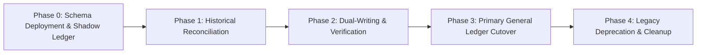

# ABAY CHESS — v4.2.6-PROD
## Master Production Architectural & Financial Specification
### Rigorous Double-Entry General Ledger, In-Transit Clearing Account Architecture, Canonical Reversal Symmetry, Distributable Cash Cap, Scoped Durable FIFO Queue, and Verified Payment Security

**Document Version:** 4.2.6-PROD  
**Document Type:** Principal Architectural, Financial & Security Production Specification  
**Status:** PENDING OWNER APPROVAL — **STRICT NO-IMPLEMENTATION PHASE**  
**Repository Basis:** `Castle-3d-multiplayer-with-ai-vercel-eve-nextjs-clerk-main`  
**Production Convex Deployment:** `qualified-greyhound-151` (`https://qualified-greyhound-151.convex.cloud`)  
**Production Domain:** `abaychess.com`  
**Stack:** Next.js 16.3.4 (App Router), React 19.2.8, TypeScript 5.6, Convex Cloud 1.45.0, Clerk 7.9.1, Tailwind CSS, pnpm 11.24  
**Security Level:** FinTech Production Grade / Zero Trust / Cryptographically Grounded  

---

## 1. EXECUTIVE ARCHITECTURE SUMMARY & OPERATIONAL BOUNDARY

### 1.1 Mission & Scope
This specification defines the master architectural, financial, and security requirements for **Abay Chess (v4.2.6-PROD)**. It resolves all architectural, accounting, concurrency, secret management, and lifecycle discrepancies identified during the read-only audit of the production repository and previous specification versions.

### 1.2 Operational Boundary: Strict No-Implementation
```
========================================================================================
                          STRICT NO-IMPLEMENTATION BOUNDARY
========================================================================================
  STATUS: PENDING EXPLICIT OWNER APPROVAL — IMPLEMENTATION STRICTLY PROHIBITED
  
  Under this specification phase:
  1. NO source code in the application repository may be modified.
  2. NO Convex schema files, database tables, or indexes may be deployed or modified.
  3. NO production data, player records, or balances may be mutated.
  4. NO environment variables on Vercel or Convex Cloud may be altered.
  5. NO production migrations or backfills may be executed.
  6. NO financial transactions may be executed or simulated against live accounts.
  
  Deliverables for v4.2.6-PROD are documentation only:
  - ABAY_CHESS_v4.2.6_PROD_SPECIFICATION.md (This Master Specification)
  - ABAY_CHESS_v4.2.6_CHANGELOG.md (Specification Delta from v4.2.5-PROD)
  - ABAY_CHESS_v4.2.6_REPOSITORY_AUDIT.md (Read-Only Codebase Audit Report)
  - ABAY_CHESS_v4.2.6_ACCEPTANCE_TEST_MATRIX.md (Verification Matrix RB-01..RB-28, OP-01..OP-08)
  - ABAY_CHESS_v4.2.6_OWNER_DECISIONS.md (Authoritative Register of Owner Decisions OD-01..OD-08)
========================================================================================
```

### 1.3 System Architecture Overview
The platform operates on a three-tier architecture: Next.js frontend hosted on Vercel, Convex Cloud backend acting as the authoritative transactional database and state engine, and Clerk managing identity authentication.

```mermaid
flowchart TD
    subgraph Client Tier [User & Staff Client Surfaces]
        UI_Player["Player Mobile & Web UI\n(/wallet, /play)"]
        UI_Admin["Admin Operations UI\n(/fssmyfkl) [Masked Views, PII Scoped]"]
        UI_Owner["Owner Command Center\n(/yyhnan) [Exclusive Payout Authority]"]
    end

    subgraph Edge & API Tier [Next.js 16.3.4 on Vercel]
        Auth_Clerk["Clerk Auth Provider\n(JWT Session Tokens)"]
        API_DepositVerify["/api/finance/deposit/verify-et\n(VERIFY_ET_API_KEY)"]
        API_WebhookVerify["/api/finance/webhook/verify-et\n(VERIFY_ET_WEBHOOK_SECRET)"]
    end

    subgraph Convex Cloud Tier [qualified-greyhound-151]
        Sec_Auth["Zero-Trust Auth Layer\n(requireOwner, requireAdminPermission, requirePlayer)"]

        subgraph Double-Entry General Ledger Core [Append-Only]
            GL_Accounts["Chart of Accounts (accounts)\n[14 Canonical Accounts incl. 1030 Clearing]"]
            GL_Transactions["Journal Transactions (journalTransactions)\n[Immutable, Reversal-Linked, Idempotent]"]
            GL_Lines["Journal Postings (journalPostings)\n[Σ Debits == Σ Credits, Integer Santims]"]
            GL_Audit["Financial Audit Logs (auditLogs)\n[Append-Only Tamper-Evident Log]"]
            GL_Recon["Statement Reconciliations (dailyReconciliations)"]
            GL_Queue["Durable Queue (durableQueue)\n[Scoped FIFO, Lease Locks, DLQ Backed]"]
        end

        subgraph Payment & Operational Entities
            Tab_PlatformDest["Platform Deposit Dest (platformPaymentDestinations)"]
            Tab_Channels["Payment Channels (paymentChannels)"]
            Tab_Balances["Player Balances Projection (playerBalances)"]
            Tab_Deposits["Deposit Requests (depositRequests)\n[4-Tier Lifecycle: Tier 1..4]"]
            Tab_Withdrawals["Withdrawals (withdrawalRequests)\n[7-Stage Lifecycle, Evidence Verified]"]
            Tab_OwnerPayouts["Owner Payouts (ownerPayoutRequests)\n[6-Stage Lifecycle, Distributable Cash Capped]"]
            Tab_SystemConfig["System Configuration (systemConfig)\n[Owner Identity & Maintenance Flags]"]
        end
    end

    subgraph External Financial Networks
        Net_VerifyEt["Verify.et API Gateway"]
        Net_CBE["Commercial Bank of Ethiopia (CBE)"]
        Net_Telebirr["Ethio Telecom Telebirr"]
    end

    UI_Player --> Auth_Clerk
    UI_Admin --> Auth_Clerk
    UI_Owner --> Auth_Clerk

    UI_Player --> API_DepositVerify
    API_DepositVerify --> Net_VerifyEt
    Net_VerifyEt --> Net_CBE
    Net_VerifyEt --> Net_Telebirr

    API_DepositVerify --> Sec_Auth
    API_WebhookVerify --> Sec_Auth
    Sec_Auth --> GL_Transactions
    GL_Transactions --> GL_Lines
    GL_Transactions --> GL_Audit
    GL_Transactions --> Tab_Balances
```



---

## 2. REPOSITORY AUDIT FINDINGS & DISCREPANCY RESOLUTION

The exhaustive read-only repository audit conducted against commit tree `Castle-3d-multiplayer-with-ai-vercel-eve-nextjs-clerk-main` revealed ten critical architectural discrepancies between the existing codebase and production requirements. Every discrepancy is formally resolved in v4.2.6-PROD.

| ID | Repository Reality | Prior Spec / Defect | v4.2.6-PROD Architectural Resolution |
| :--- | :--- | :--- | :--- |
| **AUD-01** | `convex/schema.ts` implements single-entry transaction tables (`transactions`, `payoutRequests`, `userProfiles`) without debit/credit balancing. | v4.2.5 specified general ledger tables but lacked exact Convex validator schema and migration bridge. | Section 4 provides the full 13-table general ledger schema with strict Convex validators (`v.union`, `v.literal`), compound indexes, and single-mutation atomic posting. |
| **AUD-02** | Deposits immediately credited `wallets` upon Verify.et response without tracking provider clearing status or distinguishing cleared bank cash. | Prior specs debited Account 1010/1020 directly on API verification, inflating cleared solvency with unsettled funds. | Section 3 introduces **Account 1030 (Provider Clearing / In-Transit Deposits)** in a formal 4-tier lifecycle: Tier 2 debits 1030; Tier 3 debits cleared cash (1010/1020) upon bank settlement. |
| **AUD-03** | No canonical reversal pattern existed for completed withdrawals or owner payouts; partial refunds corrupted liability ledgers. | Reversals lacked accounting symmetry and left liability accounts unbalanced. | Section 3.4 mandates a two-step balanced reversal protocol for completed payouts/withdrawals: Step 1 reverses cash to liability; Step 2 settles liability to user/retained equity. |
| **AUD-04** | Distributable earnings in prior specs were calculated purely from book equity (`3010`), permitting owner payout requests exceeding cleared cash. | Over-distribution risk: Owner could draw funds tied up in player deposits or in-transit receivables. | Section 6 institutes the **Distributable Cash Cap**: Max Payout = $\min(\text{Book Equity}, \text{Cleared Cash Surplus})$. Projected post-payout solvency must be $\ge 100\%$. |
| **AUD-05** | Owner payouts transitioned directly from `authorized` to `completed` upon receipt upload without external bank confirmation. | Administrative receipts are self-attested and do not prove bank execution. | Section 6.3 mandates the `externally_confirmed` lifecycle stage before `completed`. Receipt upload is supporting evidence only; authoritative bank confirmation is required. |
| **AUD-06** | Financial background jobs lacked concurrency protection, partitioned ordering, or idempotency state checks on replay. | Async worker retries risked duplicate ledger postings or out-of-order game settlement. | Section 11.4 specifies `durableQueue` with **Scoped FIFO** (by `gameId` or `userId`), lease locking (`leaseExpiresAt`), exponential backoff, dead-letter queue (DLQ), and mandatory pre-replay state revalidation. |
| **AUD-07** | Payment channel status in `paymentChannels` was independent of `platformPaymentDestinations`, creating UI/backend mismatch. | Inconsistent state allowed players to submit deposits to disabled bank destinations. | Section 9.3 establishes a unified channel availability rule: A channel is active if and only if both records are active, healthy, and owner-approved. |
| **AUD-08** | Hardcoded credential `DEFAULT_VERIFY_ET_API_KEY` was embedded in `src/lib/payments/verify-et/client.ts:31-32`. | Critical security vulnerability / leaked credential in client source. | Section 10 mandates immediate key revocation, purge of default fallback constants, and strict runtime assertion requiring server-only environment variables. |
| **AUD-09** | Obsolete endpoint `https://fast-oyster-971.convex.cloud` was hardcoded in `deposit/verify/route.ts:29`. | Production deployment is `qualified-greyhound-151`. Hardcoded URL causes cross-environment leakage. | Section 10 resolves all endpoints to authoritative environment variables (`CONVEX_CLOUD_URL` / `NEXT_PUBLIC_CONVEX_URL`). |
| **AUD-10** | Hardcoded email `yaredusk@gmail.com` and user ID `user_3JfrI7CJEW9GIMo1UsEAvK9M0Ki` appeared in admin UI components. | Insecure client-side authorization bypassable via DOM inspection. | Section 8 enforces zero-trust server-side authorization: Clerk user metadata verified by Convex `requireOwner` and `requireAdminPermission`. Hardcoded strings removed. |

---

## 3. DOUBLE-ENTRY FINANCIAL ACCOUNTING ARCHITECTURE

### 3.1 Chart of Accounts
The Abay Chess general ledger implements an append-only, double-entry chart of accounts. Every financial event consists of a balanced journal transaction where total debits exactly equal total credits. All monetary values are represented as non-negative 64-bit integer santims ($1\text{ ETB} = 100\text{ santims}$).

```
========================================================================================
                          CHART OF ACCOUNTS (v4.2.6-PROD)
========================================================================================
Account Code | Account Name                          | Category   | Normal Balance | Active
-------------+---------------------------------------+------------+----------------+-------
1010         | CBE Bank Account                      | Asset      | Debit          | YES
1020         | Telebirr Account                      | Asset      | Debit          | YES
1030         | Provider Clearing / In-Transit        | Asset      | Debit          | YES
1040         | CBE Birr Account                      | Asset      | Debit          | NO (Cond.)
2010         | Player Available Deposits             | Liability  | Credit         | YES
2020         | Active Match Escrow                   | Liability  | Credit         | YES
2030         | Withdrawal Payable                    | Liability  | Credit         | YES
2090         | Owner Payout Payable                  | Liability  | Credit         | YES
3010         | Retained Platform Earnings            | Equity     | Credit         | YES
3020         | Owner Capital & Distributions         | Equity     | Debit (Contra) | YES
3999         | Historical Migration Discrepancy      | Equity     | Special        | YES
4010         | Platform Commission Revenue           | Revenue    | Credit         | YES
5010         | Provider Processing Fees              | Expense    | Debit          | YES
5020         | Promotion & Bonus Expense             | Expense    | Debit          | YES
========================================================================================
```

### 3.2 Double-Entry Accounting Invariants
Every financial mutation executed in Convex must enforce the following invariants within a single ACID mutation boundary:
1. **Balanced Postings Invariant:**
   $$\sum_{i=1}^n \text{debitAmount}_i \equiv \sum_{i=1}^n \text{creditAmount}_i \quad \text{where } n \ge 2$$
2. **Integer Santims Invariant:** Every line amount must be an integer $> 0$. Fractional santims, negative amounts, and zero amounts are rejected at schema validation.
3. **Idempotency Invariant:** Every journal transaction requires a globally unique `idempotencyKey` constructed from business event identifiers. Replay attempts with an existing key return the existing transaction record without re-executing postings.
4. **Immutability Invariant:** Journal transactions and postings are strictly append-only. No `mutation` may update or delete existing posting records. Corrections require explicit, linked reversal transactions.

### 3.3 Four-Tier Deposit Verification & Ledgering
To prevent the recognition of unsettled external funds as cleared platform cash, deposits follow a four-tier lifecycle utilizing Account 1030:

```mermaid
stateDiagram-v2
    [*] --> Tier1_Initiated: Player Submits Reference
    Tier1_Initiated --> Tier2_ProviderVerified: Verify.et API Success
    Tier1_Initiated --> Rejected: Verification Failed / Invalid
    
    state Tier2_ProviderVerified {
        note right of Tier2_ProviderVerified
            Journal Entry:
            Debit 1030 (Provider Clearing)
            Credit 2010 (Player Deposits)
            Player can play matches immediately.
            Funds NOT included in Solvency Numerator.
        end note
    }
    
    Tier2_ProviderVerified --> Tier3_BankCleared: Bank Statement Match (Automated/Manual)
    
    state Tier3_BankCleared {
        note right of Tier3_BankCleared
            Journal Entry:
            Debit 1010/1020 (Cleared Cash)
            Credit 1030 (Provider Clearing)
            Funds now cleared cash.
            Eligible for Solvency Numerator.
        end note
    }
    
    Tier3_BankCleared --> Tier4_Reconciled: Period Close Audit
    Tier4_Reconciled --> [*]
```

- **Tier 1 (Initiated):** Player submits deposit transaction reference and payment channel. Record created in `depositRequests` with status `initiated`. **No ledger postings.**
- **Tier 2 (Provider Verified):** Verify.et confirms payment validity.
  * **Debit:** `1030 Provider Clearing / In-Transit Deposits`
  * **Credit:** `2010 Player Available Deposits`
  * *Result:* Player wallet balance reflects available funds for chess matches. However, because Account 1030 is clearing (not cash), this deposit cannot inflate the platform's cleared cash solvency float.
- **Tier 3 (Bank Statement Cleared):** External bank statement feed or manual reconciliation confirms the receipt of cleared funds in Abay Chess's CBE or Telebirr account.
  * **Debit:** `1010 CBE Bank Account` (or `1020 Telebirr Account`)
  * **Credit:** `1030 Provider Clearing / In-Transit Deposits`
  * *Result:* Clearing account clears to zero; settled bank cash increases; solvency coverage increases.
- **Tier 4 (Reconciled):** Monthly or daily statement match audit sealed.

### 3.4 Canonical Reversal Symmetry Protocol
When a financial transaction must be reversed, the platform enforces strict structural symmetry. A single-step reversal that bypasses intermediate accounts corrupts financial history.

#### 3.4.1 Reversal of a Completed Player Withdrawal
When a completed withdrawal must be reversed (e.g., bank transfer bounced, account invalid):
- **Step 1 (Cash Return to Payable):**
  * **Debit:** `1010 CBE Bank Account` (or `1020 Telebirr Account`)
  * **Credit:** `2030 Withdrawal Payable`
  * *Description:* Reversal of bank cash disbursement for failed withdrawal `wd_xyz`.
- **Step 2 (Liability Settlement to Player Wallet):**
  * **Debit:** `2030 Withdrawal Payable`
  * **Credit:** `2010 Player Available Deposits`
  * *Description:* Restoration of player available balance for failed withdrawal `wd_xyz`.

#### 3.4.2 Reversal of a Completed Owner Payout
When an authorized and completed owner payout must be reversed (e.g., returned by owner's bank):
- **Step 1 (Cash Return to Owner Payable):**
  * **Debit:** `1010 CBE Bank Account` (or `1020 Telebirr Account`)
  * **Credit:** `2090 Owner Payout Payable`
  * *Description:* External bank return of owner payout `payout_xyz`.
- **Step 2 (Restoration of Retained Platform Equity):**
  * **Debit:** `2090 Owner Payout Payable`
  * **Credit:** `3010 Retained Platform Earnings`
  * *Description:* Reinstatement of undistributed platform equity for returned payout `payout_xyz`.

### 3.5 Match Settlement Accounting
Match settlement follows strict rules approved by the Owner:
1. **Stake Escrow (Match Start):**
   * **Debit:** `2010 Player Available Deposits` (White Player Stake)
   * **Debit:** `2010 Player Available Deposits` (Black Player Stake)
   * **Credit:** `2020 Active Match Escrow` (Total Pot)
2. **Normal Win Settlement:**
   * Winner receives 90% of the total pot; Platform receives 10% platform commission.
   * **Debit:** `2020 Active Match Escrow` (Total Pot)
   * **Credit:** `2010 Player Available Deposits` (Winner: 90% of Pot)
   * **Credit:** `4010 Platform Commission Revenue` (Platform: 10% of Pot)
3. **Organic Draw Settlement:**
   * Stalemate, 3-fold repetition, 50-move rule, insufficient material, timeout vs insufficient material.
   * **100% full refund to both players; 0% commission.**
   * **Debit:** `2020 Active Match Escrow` (Total Pot)
   * **Credit:** `2010 Player Available Deposits` (White Player Stake)
   * **Credit:** `2010 Player Available Deposits` (Black Player Stake)
4. **Mutual Draw Settlement (Mutual Agreement):**
   * Players voluntarily agree to a draw.
   * **5% commission deduction per player (95% refund each; 5% total pot to platform).**
   * **Debit:** `2020 Active Match Escrow` (Total Pot)
   * **Credit:** `2010 Player Available Deposits` (White Player: 95% of Stake)
   * **Credit:** `2010 Player Available Deposits` (Black Player: 95% of Stake)
   * **Credit:** `4010 Platform Commission Revenue` (White Draw Fee: 5% of Stake)
   * **Credit:** `4010 Platform Commission Revenue` (Black Draw Fee: 5% of Stake)

---

## 4. COMPLETE CONVEX SCHEMA DEFINITIONS

The following 13 tables define the complete, authoritative Convex database schema.

```typescript
import { defineSchema, defineTable } from "convex/server";
import { v } from "convex/values";

export const vAdminPermission = v.union(
  v.literal("view_financial_dashboard"),
  v.literal("manage_deposits"),
  v.literal("review_withdrawals"),
  v.literal("manage_users"),
  v.literal("manage_games"),
  v.literal("view_audit_logs"),
  v.literal("view_payment_pii"),
  v.literal("manage_payment_channels")
);

export default defineSchema({
  // 1. Chart of Accounts
  accounts: defineTable({
    code: v.string(), // "1010", "1020", "1030", etc.
    name: v.string(),
    category: v.union(
      v.literal("asset"),
      v.literal("liability"),
      v.literal("equity"),
      v.literal("revenue"),
      v.literal("expense")
    ),
    normalBalance: v.union(v.literal("debit"), v.literal("credit")),
    description: v.string(),
    isActive: v.boolean(),
    createdAt: v.number(),
    updatedAt: v.number(),
  }).index("by_code", ["code"]),

  // 2. Journal Transactions (Transaction Headers)
  journalTransactions: defineTable({
    transactionId: v.string(), // e.g. "tx_20261101_001"
    idempotencyKey: v.string(), // unique constraint
    type: v.union(
      v.literal("deposit_tier2"),
      v.literal("deposit_tier3"),
      v.literal("stake_escrow"),
      v.literal("match_win"),
      v.literal("match_organic_draw"),
      v.literal("match_mutual_draw"),
      v.literal("withdrawal_lock"),
      v.literal("withdrawal_execute"),
      v.literal("withdrawal_reversal_step1"),
      v.literal("withdrawal_reversal_step2"),
      v.literal("owner_payout_reserve"),
      v.literal("owner_payout_execute"),
      v.literal("owner_payout_reversal_step1"),
      v.literal("owner_payout_reversal_step2"),
      v.literal("migration_initial_balance"),
      v.literal("reconciliation_adjustment")
    ),
    referenceId: v.string(), // depositRequestId, matchId, etc.
    description: v.string(),
    totalAmountSantims: v.int64(),
    postedAt: v.number(),
    postedBy: v.string(), // userId, "system", or "worker"
    isReversed: v.boolean(),
    reversalTransactionId: v.optional(v.string()),
    metadata: v.optional(v.any()),
  })
    .index("by_transactionId", ["transactionId"])
    .index("by_idempotencyKey", ["idempotencyKey"])
    .index("by_type", ["type"])
    .index("by_referenceId", ["referenceId"])
    .index("by_postedAt", ["postedAt"]),

  // 3. Journal Postings (Line Items: Debits & Credits)
  journalPostings: defineTable({
    transactionId: v.string(), // references journalTransactions.transactionId
    accountCode: v.string(), // "1010", "2010", etc.
    entryType: v.union(v.literal("debit"), v.literal("credit")),
    amountSantims: v.int64(), // strictly > 0
    entityType: v.optional(v.union(v.literal("player"), v.literal("platform"), v.literal("owner"))),
    entityId: v.optional(v.string()), // userId for player
    postedAt: v.number(),
  })
    .index("by_transactionId", ["transactionId"])
    .index("by_accountCode", ["accountCode", "postedAt"])
    .index("by_entity", ["entityType", "entityId", "postedAt"]),

  // 4. Daily Reconciliations
  dailyReconciliations: defineTable({
    reconciliationDate: v.string(), // "YYYY-MM-DD"
    accountCode: v.string(),
    externalStatementBalanceSantims: v.int64(),
    generalLedgerBalanceSantims: v.int64(),
    discrepancySantims: v.int64(), // external - GL
    status: v.union(v.literal("balanced"), v.literal("discrepancy_flagged"), v.literal("investigating"), v.literal("cleared")),
    verifiedBy: v.string(), // Clerk userId of Admin/Owner
    notes: v.optional(v.string()),
    createdAt: v.number(),
    updatedAt: v.number(),
  })
    .index("by_date_account", ["reconciliationDate", "accountCode"])
    .index("by_status", ["status"]),

  // 5. Financial Audit Logs (Append-Only)
  auditLogs: defineTable({
    action: v.string(), // e.g., "owner_payout_authorized", "pii_revealed", "solvency_halt"
    performedBy: v.string(), // Clerk userId
    userRole: v.union(v.literal("player"), v.literal("admin"), v.literal("owner"), v.literal("system")),
    targetEntity: v.string(), // "withdrawalRequest", "ownerPayoutRequest", etc.
    targetId: v.string(),
    previousState: v.optional(v.string()),
    newState: v.optional(v.string()),
    ipAddress: v.optional(v.string()),
    userAgent: v.optional(v.string()),
    reason: v.optional(v.string()),
    timestamp: v.number(),
  })
    .index("by_action", ["action", "timestamp"])
    .index("by_performedBy", ["performedBy", "timestamp"])
    .index("by_target", ["targetEntity", "targetId", "timestamp"]),

  // 6. Player Balances (Cached General Ledger Projection)
  playerBalances: defineTable({
    userId: v.string(), // Clerk userId
    availableSantims: v.int64(),
    inPlayEscrowSantims: v.int64(),
    pendingWithdrawalSantims: v.int64(),
    lifetimeDepositedSantims: v.int64(),
    lifetimeWithdrawnSantims: v.int64(),
    lifetimeNetWinningsSantims: v.int64(),
    lastJournalTransactionId: v.string(),
    updatedAt: v.number(),
  }).index("by_userId", ["userId"]),

  // 7. Deposit Requests
  depositRequests: defineTable({
    requestId: v.string(),
    userId: v.string(),
    amountSantims: v.int64(),
    channelId: v.string(), // "cbe_account" or "telebirr"
    providerReference: v.string(),
    status: v.union(
      v.literal("initiated"),
      v.literal("provider_verified"),
      v.literal("bank_cleared"),
      v.literal("reconciled"),
      v.literal("rejected"),
      v.literal("refunded")
    ),
    verifyEtTxId: v.optional(v.string()),
    payerAccountMasked: v.string(),
    payerAccountEncrypted: v.optional(v.string()),
    failureReason: v.optional(v.string()),
    tier2TransactionId: v.optional(v.string()),
    tier3TransactionId: v.optional(v.string()),
    createdAt: v.number(),
    updatedAt: v.number(),
  })
    .index("by_requestId", ["requestId"])
    .index("by_user", ["userId", "createdAt"])
    .index("by_status", ["status"])
    .index("by_providerRef", ["providerReference"]),

  // 8. Withdrawal Requests
  withdrawalRequests: defineTable({
    requestId: v.string(),
    userId: v.string(),
    amountSantims: v.int64(),
    destinationChannel: v.union(v.literal("cbe_account"), v.literal("telebirr")),
    destinationAccountMasked: v.string(),
    destinationAccountEncrypted: v.string(),
    accountHolderName: v.string(),
    status: v.union(
      v.literal("requested"),
      v.literal("under_review"),
      v.literal("approved"),
      v.literal("processing"),
      v.literal("completed"),
      v.literal("rejected"),
      v.literal("cancelled"),
      v.literal("reversed")
    ),
    reviewedBy: v.optional(v.string()),
    executedBy: v.optional(v.string()),
    rejectionReason: v.optional(v.string()),
    lockTransactionId: v.optional(v.string()),
    executeTransactionId: v.optional(v.string()),
    reversalTransactionId: v.optional(v.string()),
    createdAt: v.number(),
    updatedAt: v.number(),
  })
    .index("by_requestId", ["requestId"])
    .index("by_user", ["userId", "createdAt"])
    .index("by_status", ["status"]),

  // 9. Owner Payout Requests
  ownerPayoutRequests: defineTable({
    requestId: v.string(),
    ownerUserId: v.string(),
    amountSantims: v.int64(),
    destinationAccountMasked: v.string(),
    destinationAccountEncrypted: v.string(),
    destinationBank: v.string(),
    status: v.union(
      v.literal("draft"),
      v.literal("requested"),
      v.literal("authorized"),
      v.literal("escrowed"),
      v.literal("externally_confirmed"),
      v.literal("completed"),
      v.literal("rejected"),
      v.literal("cancelled"),
      v.literal("reversed")
    ),
    distributableEquityAtRequest: v.int64(),
    eligibleClearedCashAtRequest: v.int64(),
    projectedSolvencyRatioAtRequest: v.float64(),
    receiptStorageId: v.optional(v.string()),
    bankStatementReference: v.optional(v.string()),
    reserveTransactionId: v.optional(v.string()),
    executeTransactionId: v.optional(v.string()),
    reversalTransactionId: v.optional(v.string()),
    authorizedAt: v.optional(v.number()),
    externallyConfirmedAt: v.optional(v.number()),
    completedAt: v.optional(v.number()),
    createdAt: v.number(),
    updatedAt: v.number(),
  })
    .index("by_requestId", ["requestId"])
    .index("by_status", ["status"])
    .index("by_createdAt", ["createdAt"]),

  // 10. Payment Channels
  paymentChannels: defineTable({
    channelId: v.string(), // "cbe_account", "telebirr", "cbe_birr"
    name: v.string(),
    type: v.union(v.literal("bank_transfer"), v.literal("mobile_money")),
    minDepositSantims: v.int64(),
    maxDepositSantims: v.int64(),
    minWithdrawalSantims: v.int64(),
    maxWithdrawalSantims: v.int64(),
    status: v.union(v.literal("active"), v.literal("maintenance"), v.literal("disabled")),
    supportsInstantVerification: v.boolean(),
    updatedAt: v.number(),
  }).index("by_channelId", ["channelId"]),

  // 11. Platform Payment Destinations
  platformPaymentDestinations: defineTable({
    destinationId: v.string(),
    channelId: v.string(), // "cbe_account", "telebirr", "cbe_birr"
    accountNumberMasked: v.string(), // "1000723226426" -> masked on general UI
    accountNumberEncrypted: v.string(),
    accountHolderName: v.string(),
    qrCodeStorageId: v.optional(v.string()),
    isActive: v.boolean(),
    approvedByOwnerAt: v.number(),
    updatedAt: v.number(),
  })
    .index("by_channelId", ["channelId"])
    .index("by_isActive", ["isActive"]),

  // 12. Durable Queue (Async Settlement, DLQ, Scoped FIFO)
  durableQueue: defineTable({
    taskId: v.string(),
    taskType: v.union(
      v.literal("process_match_settlement"),
      v.literal("process_deposit_tier3"),
      v.literal("execute_withdrawal_transfer"),
      v.literal("execute_owner_payout_transfer"),
      v.literal("reconcile_daily_ledger")
    ),
    scopeKey: v.string(), // "game:<gameId>" or "user:<userId>" for Scoped FIFO
    payload: v.any(),
    status: v.union(v.literal("pending"), v.literal("processing"), v.literal("completed"), v.literal("failed"), v.literal("dead_letter")),
    retryCount: v.number(),
    maxRetries: v.number(),
    leaseExpiresAt: v.number(),
    lastError: v.optional(v.string()),
    dlqReason: v.optional(v.string()),
    scheduledAt: v.number(),
    completedAt: v.optional(v.number()),
  })
    .index("by_scope_status", ["scopeKey", "status", "scheduledAt"])
    .index("by_status_lease", ["status", "leaseExpiresAt"])
    .index("by_scheduledAt", ["scheduledAt"]),

  // 13. System Configuration & Owner Identity
  systemConfig: defineTable({
    key: v.string(), // "owner_identity", "solvency_guard", "maintenance_mode"
    value: v.any(),
    updatedBy: v.string(), // Clerk userId
    updatedAt: v.number(),
  }).index("by_key", ["key"]),
});
```

---

## 5. FINANCIAL JOURNAL POSTING EXAMPLES (BALANCED TABLES)

All scenarios below demonstrate exact debit and credit equality. Amounts are formatted in ETB for clarity with underlying integer santims.

### 5.1 Scenario 1: Deposit Tier 2 (Verify.et Verification)
Player deposits 500.00 ETB (50,000 santims) via CBE. Verify.et confirms payment.
```
========================================================================================
Journal Transaction: tx_dep_t2_101 | Type: deposit_tier2 | Ref: dep_req_789
Idempotency: dep:dep_req_789:tier2
----------------------------------------------------------------------------------------
Account Code | Account Name                          | Debit (ETB) | Credit (ETB)
-------------+---------------------------------------+-------------+-------------
1030         | Provider Clearing / In-Transit        | 500.00      | -
2010         | Player Available Deposits (Player A)  | -           | 500.00
----------------------------------------------------------------------------------------
TOTALS                                               | 500.00      | 500.00 (BALANCED)
========================================================================================
```

### 5.2 Scenario 2: Deposit Tier 3 (Bank Statement Match)
Abay Chess bank feed confirms 500.00 ETB settled into CBE account.
```
========================================================================================
Journal Transaction: tx_dep_t3_102 | Type: deposit_tier3 | Ref: dep_req_789
Idempotency: dep:dep_req_789:tier3
----------------------------------------------------------------------------------------
Account Code | Account Name                          | Debit (ETB) | Credit (ETB)
-------------+---------------------------------------+-------------+-------------
1010         | CBE Bank Account                      | 500.00      | -
1030         | Provider Clearing / In-Transit        | -           | 500.00
----------------------------------------------------------------------------------------
TOTALS                                               | 500.00      | 500.00 (BALANCED)
========================================================================================
```

### 5.3 Scenario 3: Match Stake Escrow
Player White and Player Black each stake 100.00 ETB (10,000 santims). Total pot: 200.00 ETB.
```
========================================================================================
Journal Transaction: tx_escrow_201 | Type: stake_escrow | Ref: match_456
Idempotency: match:match_456:escrow
----------------------------------------------------------------------------------------
Account Code | Account Name                          | Debit (ETB) | Credit (ETB)
-------------+---------------------------------------+-------------+-------------
2010         | Player Available Deposits (Player W)  | 100.00      | -
2010         | Player Available Deposits (Player B)  | 100.00      | -
2020         | Active Match Escrow                   | -           | 200.00
----------------------------------------------------------------------------------------
TOTALS                                               | 200.00      | 200.00 (BALANCED)
========================================================================================
```

### 5.4 Scenario 4: Normal Win Settlement (10% Commission)
Player White wins. Winner receives 180.00 ETB (90% of pot); Platform takes 20.00 ETB (10% commission).
```
========================================================================================
Journal Transaction: tx_settle_win_202 | Type: match_win | Ref: match_456
Idempotency: match:match_456:win
----------------------------------------------------------------------------------------
Account Code | Account Name                          | Debit (ETB) | Credit (ETB)
-------------+---------------------------------------+-------------+-------------
2020         | Active Match Escrow                   | 200.00      | -
2010         | Player Available Deposits (Player W)  | -           | 180.00
4010         | Platform Commission Revenue           | -           | 20.00
----------------------------------------------------------------------------------------
TOTALS                                               | 200.00      | 200.00 (BALANCED)
========================================================================================
```

### 5.5 Scenario 5: Organic Draw Settlement (100% Full Refund)
Match ends in stalemate / 50-move rule / repetition. Both players refunded in full. 0% commission.
```
========================================================================================
Journal Transaction: tx_draw_org_203 | Type: match_organic_draw | Ref: match_457
Idempotency: match:match_457:organic_draw
----------------------------------------------------------------------------------------
Account Code | Account Name                          | Debit (ETB) | Credit (ETB)
-------------+---------------------------------------+-------------+-------------
2020         | Active Match Escrow                   | 200.00      | -
2010         | Player Available Deposits (Player W)  | -           | 100.00
2010         | Player Available Deposits (Player B)  | -           | 100.00
----------------------------------------------------------------------------------------
TOTALS                                               | 200.00      | 200.00 (BALANCED)
========================================================================================
```

### 5.6 Scenario 6: Mutual Draw Settlement (5% Commission per Player)
Players agree to a draw. White and Black receive 95.00 ETB each; Platform takes 5.00 ETB from each (10.00 ETB total).
```
========================================================================================
Journal Transaction: tx_draw_mut_204 | Type: match_mutual_draw | Ref: match_458
Idempotency: match:match_458:mutual_draw
----------------------------------------------------------------------------------------
Account Code | Account Name                          | Debit (ETB) | Credit (ETB)
-------------+---------------------------------------+-------------+-------------
2020         | Active Match Escrow                   | 200.00      | -
2010         | Player Available Deposits (Player W)  | -           | 95.00
2010         | Player Available Deposits (Player B)  | -           | 95.00
4010         | Platform Commission Revenue (White)   | -           | 5.00
4010         | Platform Commission Revenue (Black)   | -           | 5.00
----------------------------------------------------------------------------------------
TOTALS                                               | 200.00      | 200.00 (BALANCED)
========================================================================================
```

### 5.7 Scenario 7: Player Withdrawal Execution & Reversal
Player A requests 400.00 ETB withdrawal.

**Stage A: Withdrawal Lock (Reservation)**
```
========================================================================================
Journal Transaction: tx_wd_lock_301 | Type: withdrawal_lock | Ref: wd_req_501
Idempotency: wd:wd_req_501:lock
----------------------------------------------------------------------------------------
Account Code | Account Name                          | Debit (ETB) | Credit (ETB)
-------------+---------------------------------------+-------------+-------------
2010         | Player Available Deposits (Player A)  | 400.00      | -
2030         | Withdrawal Payable                    | -           | 400.00
----------------------------------------------------------------------------------------
TOTALS                                               | 400.00      | 400.00 (BALANCED)
========================================================================================
```

**Stage B: Bank Execution (Disbursement)**
```
========================================================================================
Journal Transaction: tx_wd_exec_302 | Type: withdrawal_execute | Ref: wd_req_501
Idempotency: wd:wd_req_501:execute
----------------------------------------------------------------------------------------
Account Code | Account Name                          | Debit (ETB) | Credit (ETB)
-------------+---------------------------------------+-------------+-------------
2030         | Withdrawal Payable                    | 400.00      | -
1010         | CBE Bank Account                      | -           | 400.00
----------------------------------------------------------------------------------------
TOTALS                                               | 400.00      | 400.00 (BALANCED)
========================================================================================
```

**Stage C: Reversal of Failed/Returned Withdrawal (Canonical 2-Step)**
```
----------------------------------------------------------------------------------------
Step 1: Cash Returned to Platform Payable (Ref: wd_req_501)
Idempotency: wd:wd_req_501:rev_step1
----------------------------------------------------------------------------------------
Account Code | Account Name                          | Debit (ETB) | Credit (ETB)
-------------+---------------------------------------+-------------+-------------
1010         | CBE Bank Account                      | 400.00      | -
2030         | Withdrawal Payable                    | -           | 400.00
----------------------------------------------------------------------------------------
TOTALS (Step 1)                                      | 400.00      | 400.00 (BALANCED)
----------------------------------------------------------------------------------------
Step 2: Restoring Player Available Balance (Ref: wd_req_501)
Idempotency: wd:wd_req_501:rev_step2
----------------------------------------------------------------------------------------
Account Code | Account Name                          | Debit (ETB) | Credit (ETB)
-------------+---------------------------------------+-------------+-------------
2030         | Withdrawal Payable                    | 400.00      | -
2010         | Player Available Deposits (Player A)  | -           | 400.00
----------------------------------------------------------------------------------------
TOTALS (Step 2)                                      | 400.00      | 400.00 (BALANCED)
========================================================================================
```

---

## 6. REVENUE CLOSING, DISTRIBUTABLE CASH CAP, AND OWNER PAYOUT ACCOUNTING

### 6.1 Distributable Cash Cap vs Book Distributable Equity
To guarantee that owner profit distributions can never impair customer deposits or exploit uncollected clearing receivables, v4.2.6-PROD institutes a strict **Distributable Cash Cap**.

$$\text{Max Distributable Payout} = \min(\text{Book Distributable Equity}, \text{Eligible Cleared Cash Surplus})$$

Where:
1. **Book Distributable Equity:**
   $$\text{Book Distributable Equity} = \text{Balance}(3010) - \text{Balance}(3020) - \text{Minimum Capital Buffer (100,000 santims)}$$
2. **Eligible Cleared Cash Surplus:**
   $$\text{Eligible Cleared Cash Surplus} = (\text{Balance}(1010) + \text{Balance}(1020)) - (\text{Balance}(2010) + \text{Balance}(2020) + \text{Balance}(2030) + \text{Balance}(2090)) - \text{Operational Buffer}$$

### 6.2 Pre-Authorization Solvency Invariant
Before any Owner Payout can be authorized:
$$\text{Projected Post-Payout Solvency} = \frac{(\text{Balance}(1010) + \text{Balance}(1020)) - \text{Requested Payout}}{\text{Total Obligations} - \text{Requested Payout}} \ge 105\%$$
If the projected solvency falls below $105\%$, Convex rejects the authorization mutation.

### 6.3 Authoritative Six-Stage Owner Payout Lifecycle
```mermaid
stateDiagram-v2
    [*] --> Draft: Owner Enters Payout Details
    Draft --> Requested: Owner Submits Request
    Requested --> Authorized: Owner Re-authenticates (2FA / PIN)
    Authorized --> Escrowed: Convex Locks Equity & Creates 2090 Payable
    
    state Escrowed {
        note right of Escrowed
            Journal Entry:
            Debit 3010 (Retained Earnings)
            Credit 2090 (Owner Payout Payable)
            Cash not yet disbursed.
        end note
    }
    
    Escrowed --> Externally_Confirmed: Owner Disburses & Provides Bank Ref
    Externally_Confirmed --> Completed: Authoritative Bank Match Verified
    
    state Completed {
        note right of Completed
            Journal Entry:
            Debit 2090 (Owner Payout Payable)
            Credit 1010/1020 (Bank Cash)
            Disbursement finalized.
        end note
    }
    
    Completed --> [*]
    
    Requested --> Cancelled: Owner Cancels
    Authorized --> Rejected: Validation Fails
```

- **Receipt Attachment Rule:** Upload of a bank transfer receipt image is treated strictly as **supporting documentation**, not proof of execution. The payout remains in `externally_confirmed` until the transaction reference appears on the platform's official bank statement.

---

## 7. SOLVENCY AND RECONCILIATION MODEL

### 7.1 Authoritative Solvency Formula
The platform solvency ratio measures the exact coverage of all customer and operational liabilities by verified, cleared cash:

$$\text{Solvency Ratio} = \frac{\text{Eligible Cleared Cash}}{\text{Total Outstanding Obligations}} = \frac{\text{Balance}(1010) + \text{Balance}(1020)}{\text{Balance}(2010) + \text{Balance}(2020) + \text{Balance}(2030) + \text{Balance}(2090)}$$

### 7.2 Strict Exclusion of In-Transit Clearing (Account 1030)
Account 1030 (Provider Clearing / In-Transit Deposits) represents funds claimed by Verify.et but not yet settled in Abay Chess's physical bank accounts.
- **Rule:** Account 1030 is **strictly excluded** from the solvency ratio numerator.
- **Rationale:** Counting in-transit receivables as cash creates phantom liquidity. If a third-party gateway delays or claws back payments, an exchange relying on uncollected receivables experiences an insolvency cascade.

### 7.3 Account 3999 (Historical Migration Discrepancy) Sign Rules
During Phase 1 cutover, legacy ledger discrepancies are isolated into Account 3999:
- **Debit Balance in 3999 ($>0$):** Indicates historical cash shortfall (legacy liability records exceed verified physical bank cash). Treated as an immediate deduction from equity ($3010$). Must be funded by Owner capital injection before profit payouts resume.
- **Credit Balance in 3999 ($<0$):** Indicates historical cash surplus. Quarantined in equity; cannot be recognized as distributable earnings until fully audited.

### 7.4 Automated Solvency Thresholds & Response
```
========================================================================================
                               SOLVENCY THRESHOLD MATRIX
========================================================================================
Solvency Ratio       | Status  | Operational Impact & System Action
---------------------+---------+--------------------------------------------------------
Ratio >= 105%        | HEALTHY | Full operational status. Normal deposits, games,
                     |         | withdrawals, and eligible owner payouts permitted.
---------------------+---------+--------------------------------------------------------
100% <= Ratio < 105% | CAUTION | 1. Owner payout requests automatically blocked.
                     |         | 2. Player withdrawals over 2,000 ETB queued for review.
                     |         | 3. High-priority Slack/SMS alert to Owner.
---------------------+---------+--------------------------------------------------------
Ratio < 100%         | BREACH  | 1. AUTOMATIC CRITICAL HALT: All withdrawals locked.
                     |         | 2. Game stakes capped at 50 ETB max.
                     |         | 3. Immediate incident log generated.
                     |         | 4. Owner must execute capital injection to unfreeze.
========================================================================================
```

---

## 8. AUTHENTICATION, AUTHORIZATION, AND OWNER INITIALIZATION

### 8.1 Zero-Trust Role Hierarchy
The application enforces three distinct authorization tiers verified by Clerk session tokens and Convex server-side claims:
1. **Player:** Standard authenticated customer. Can view own wallet, initiate deposits/withdrawals, join matches.
2. **Admin:** Customer support and compliance staff. Assigned granular permissions defined by `vAdminPermission`. Strictly barred from approving owner payouts, modifying owner destinations, or viewing unmasked payment credentials without explicit audit logging.
3. **Owner:** Root authority. Sole user permitted to authorize platform profit distributions, approve new platform deposit destinations, initiate owner rotation, and reset system emergency halt.

### 8.2 Single Owner Bootstrap & Emergency Recovery Protocol
- **Initial Bootstrap:** Upon initial deployment of v4.2.6-PROD schema, if `systemConfig` contains no record for `owner_identity`, the first authenticated Clerk user with matching email `yaredusk@gmail.com` executing the setup mutation is registered as Owner.
- **Out-of-Band Emergency Recovery Tool:** If the Owner Clerk account is compromised or locked out, recovery is executed via a local CLI script (`scripts/recover-owner.ts`) using the Convex Admin Deploy Key:
  ```bash
  pnpm ts-node scripts/recover-owner.ts --target-user-id "user_newClerkId" --reason "Owner Account Migration"
  ```
  The script directly writes the updated `owner_identity` to `systemConfig` and appends an immutable entry to `auditLogs`.

### 8.3 Staged Owner Rotation Protocol
Transferring platform ownership requires a secure four-stage handshake:
1. **Stage 1 (Initiate):** Current Owner calls `initiateOwnerRotation(nomineeUserId)`. System generates a cryptographic rotation challenge and enters 48-hour timelock.
2. **Stage 2 (Nominee Acceptance):** Nominee signs in and accepts the challenge using MFA.
3. **Stage 3 (Timelock Grace Period):** 48-hour cooling-off window during which current Owner can cancel.
4. **Stage 4 (Activation):** System updates `systemConfig.owner_identity` to nominee. Old Owner permissions immediately downgraded.

---

## 9. PAYMENT ARCHITECTURE, APPROVED DESTINATIONS & DATA PRIVACY

### 9.1 Three Distinct Payment Domains
Abay Chess maintains absolute separation between three payment destination domains:
1. **Platform Deposit Destinations:** Bank accounts owned by Abay Chess that players transfer money into.
2. **Player Withdrawal Destinations:** Personal bank accounts or mobile wallets owned by players where withdrawal disbursements are sent.
3. **Owner Payout Destinations:** Personal bank accounts owned by the Owner where platform profits are disbursed.

### 9.2 Approved Platform Deposit Destinations
Only the following approved deposit destinations are permitted in production:

```
========================================================================================
                     APPROVED PLATFORM DEPOSIT DESTINATIONS
========================================================================================
Channel      | Account / Phone Number | Account Holder Name | Status     | Notes
-------------+------------------------+---------------------+------------+--------------
CBE Account  | 1000723226426          | Yared Fikadu Bekele | MANDATORY  | Core Bank
Telebirr     | 093307470              | Yared Fikadu Bekele | MANDATORY  | Core Mobile
CBE Birr     | 0933074790             | Yared Fikadu Bekele | CONDITIONAL| DISABLED (1)
========================================================================================
```
*(1) CBE Birr remains strictly disabled until automated verification is certified by the provider and approved by the Owner.*

### 9.3 Unified Channel Availability Rule
A payment channel is active on the player interface if and only if:
$$\text{Channel Active} \iff (\text{paymentChannels.status} == \text{"active"}) \land (\text{platformPaymentDestinations.isActive} == \text{true}) \land (\text{Gateway Health} == \text{"operational"})$$

### 9.4 PII Masking & Cryptographic Encryption
- **Client Presentation:** Account numbers and phone numbers are masked everywhere in user interfaces and standard logs:
  * CBE Account: `1000723226426` $\rightarrow$ `•••••••••26426`
  * Telebirr Phone: `093307470` $\rightarrow$ `09•••••470`
- **Field-Level Encryption:** Unmasked credentials stored in Convex are encrypted using AES-256-GCM with `INTERNAL_SERVICE_SECRET`.
- **Audited Unmasking:** Revealing an unmasked account number in the Admin UI requires the `view_payment_pii` permission and automatically logs an event in `auditLogs` containing the staff user ID, target entity, timestamp, and client IP.

---

## 10. VERIFY.ET CONFIGURATION & SECRET RECONCILIATION

### 10.1 Secret Environment Reconciliation
The audit identified discrepancies between Next.js and Convex environment naming. The following unified secret taxonomy is enforced:

```
========================================================================================
                          PRODUCTION SECRET CONFIGURATION
========================================================================================
Secret Variable Name         | Target Runtime   | Description & Purpose
-----------------------------+------------------+---------------------------------------
VERIFY_ET_API_KEY            | Vercel (Next.js) | Production API Key for Verify.et Gateway
VERIFY_ET_WEBHOOK_SECRET     | Vercel & Convex  | HMAC Signature verification for webhooks
INTERNAL_SERVICE_SECRET      | Vercel & Convex  | AES-256 PII encryption & service auth
NEXT_PUBLIC_CONVEX_URL       | Vercel (Next.js) | Production URL (qualified-greyhound-151)
CONVEX_CLOUD_URL             | Vercel Server    | Production URL (qualified-greyhound-151)
========================================================================================
```

### 10.2 Leaked Credential Revocation & Fallback Elimination
- **Finding:** A hardcoded key `DEFAULT_VERIFY_ET_API_KEY` was discovered in `src/lib/payments/verify-et/client.ts`.
- **Immediate Requirement:**
  1. Revoke and rotate the exposed Verify.et API key in the provider portal.
  2. Permanently delete lines 31-32 in `src/lib/payments/verify-et/client.ts`.
  3. Replace with strict runtime validation:
     ```typescript
     const apiKey = process.env.VERIFY_ET_API_KEY;
     if (!apiKey) {
       throw new Error("FATAL: VERIFY_ET_API_KEY environment variable is not configured.");
     }
     ```
- **Correction of Convex URL:** Remove hardcoded fallback `https://fast-oyster-971.convex.cloud` from `deposit/verify/route.ts:29`. Use `process.env.CONVEX_CLOUD_URL`.

---

## 11. CONTROLLED FINANCIAL CUTOVER, DATA MIGRATION & DURABLE QUEUE

### 11.1 Five-Phase Zero-Downtime Cutover Strategy


- **Phase 0 (Schema Deployment):** Deploy 13 general ledger tables to `qualified-greyhound-151`. Initialize `accounts` with the 14 standard codes. Application continues reading/writing legacy tables.
- **Phase 1 (Historical Reconciliation):** Execute migration script:
  * Sum legacy balances across all user profiles.
  * Compare against verified external CBE and Telebirr bank statements.
  * Post baseline journal entries: Debit `1010/1020`, Credit `2010` (Player Balances), Credit `3010` (Retained Earnings), Offset to `3999` (Historical Migration Discrepancy).
- **Phase 2 (Dual-Writing):** Backend writes transactions to both legacy tables and new General Ledger. Automated validator compares balances in background.
- **Phase 3 (Primary Cutover):** UI and backend switch to General Ledger as primary source of truth. Legacy tables marked read-only.
- **Phase 4 (Legacy Deprecation):** Legacy tables archived and removed from schema.

### 11.2 Operation Write-Freeze Matrix Across Cutover Phases
```
========================================================================================
                           CUTOVER WRITE-FREEZE MATRIX
========================================================================================
Operation Type               | Phase 0 | Phase 1 (15m) | Phase 2 | Phase 3 (5m) | Phase 4
-----------------------------+---------+---------------+---------+--------------+--------
Game Play / Chess Moves      | OPEN    | OPEN          | OPEN    | OPEN         | OPEN
Deposit Submission           | OPEN    | QUEUED        | OPEN    | QUEUED       | OPEN
Withdrawal Requests          | OPEN    | FROZEN        | OPEN    | FROZEN       | OPEN
Match Settlement             | OPEN    | QUEUED        | OPEN    | QUEUED       | OPEN
Owner Profit Distributions   | FROZEN  | FROZEN        | FROZEN  | FROZEN       | OPEN
========================================================================================
```

### 11.3 Historical Migration Reconciliation Formula
$$\text{Bank Cash} (1010 + 1020) \equiv \text{Player Balances} (2010) + \text{Retained Earnings} (3010) + \text{Discrepancy} (3999)$$

### 11.4 Durable Queue: Scoped FIFO, Lease Locking & DLQ
All asynchronous financial processing (e.g., match settlements, deposit verification callbacks, withdrawal processing) is mediated by `durableQueue`:
1. **Scoped FIFO Ordering:** Tasks are partitioned by `scopeKey` (e.g., `game:game_123` or `user:user_456`). A worker will not execute a task for a given scope if an earlier task in that scope is pending or processing.
2. **Lease Locking (`leaseExpiresAt`):** When a worker claims a task, it sets `leaseExpiresAt = Date.now() + 30_000` (30-second lease). If the worker crashes, the lease expires and another worker reclaims it.
3. **Pre-Replay State Revalidation:** When retrying a failed task, the worker must check the current database state before re-executing ledger mutations. If the underlying match or withdrawal is already settled, the task is marked completed immediately without re-posting.
4. **Dead-Letter Queue (DLQ):** If a task fails after 5 retries (`retryCount >= maxRetries`), it transitions to `dead_letter` status with a captured `dlqReason`. DLQ entries generate high-priority administrative alerts and can only be replayed via manual administrative action.

---

## 12. COMPREHENSIVE TEST AND VERIFICATION MATRIX

The platform must satisfy 100% of acceptance tests detailed in `ABAY_CHESS_v4.2.6_ACCEPTANCE_TEST_MATRIX.md` before production deployment:

### 12.1 Rollback, Invariance & Concurrency Test Summary (RB-01 to RB-28)
- **RB-01 to RB-08 (Financial Invariants):** Balanced debit/credit enforcement, non-negative santims, unique idempotency keys, single-mutation atomicity.
- **RB-09 to RB-12 (Match Settlements):** 10% win commission, 100% organic draw refund, 5% mutual draw commission per player, double-spend prevention on rapid result claims.
- **RB-13 to RB-16 (Deposit Verification):** 4-tier lifecycle, Provider Clearing Account 1030 behavior, replay prevention of bank transaction references.
- **RB-17 to RB-20 (Withdrawal Lifecycle):** Two-step balanced reversal symmetry, balance reservation under concurrent match play, rejection handling.
- **RB-21 to RB-24 (Owner Distributions & Solvency):** Distributable Cash Cap enforcement, projected solvency ratio calculation, mandatory `externally_confirmed` stage, multi-admin authorization lockout.
- **RB-25 to RB-28 (Queue Concurrency & Resiliency):** Scoped FIFO execution order, lease lock expiration and zombie worker recovery, DLQ routing, zero duplicate postings under forced network aborts.

### 12.2 Operational Verification Scenarios (OP-01 to OP-08)
- **OP-01:** Complete end-to-end player deposit via CBE with Verify.et verification.
- **OP-02:** Normal chess match resolution with 10% platform commission calculation.
- **OP-03:** Mutual draw agreement with 5% deduction per player.
- **OP-04:** Organic draw stalemate with full 100% stakes refund.
- **OP-05:** Player withdrawal request, admin review, CBE bank disbursement, and completion.
- **OP-06:** Owner profit payout calculation under Distributable Cash Cap and bank confirmation.
- **OP-07:** Automated solvency threshold breach simulation ($<100\%$) and withdrawal lock verification.
- **OP-08:** Out-of-band CLI Owner account recovery.

---

## 13. OWNER DECISION REGISTER SUMMARY

The following key decisions are documented in `ABAY_CHESS_v4.2.6_OWNER_DECISIONS.md` awaiting final Owner sign-off:

```
========================================================================================
                          OWNER DECISION REGISTER SUMMARY
========================================================================================
Decision ID | Subject                              | Recommended Option         | Status
------------+--------------------------------------+----------------------------+-------
OD-01       | Minimum Owner Capital Reserve        | 1,000.00 ETB (100,000 s.)  | PENDING
OD-02       | Solvency Caution Threshold           | 105% Coverage Ratio        | PENDING
OD-03       | High-Value Withdrawal Review Limit  | 2,000.00 ETB (200,000 s.)  | PENDING
OD-04       | CBE Birr Channel Re-activation       | Disabled until Verified    | PENDING
OD-05       | Phase 1 Cutover Maintenance Window   | Sunday 02:00-04:00 EAT     | PENDING
OD-06       | Async Task Max Retries Before DLQ    | 5 Retries (Exponential)    | PENDING
OD-07       | Historical Discrepancy (3999) Policy | Quarantined in Equity      | PENDING
OD-08       | Payment PII Unmasking Audit Policy   | Elevated RBAC + Audit Log  | PENDING
========================================================================================
```

---

## 14. FINAL APPROVAL CHECKLIST

Before any code modification or implementation phase may commence, the Owner must complete and sign the following verification checklist:

- [ ] **1. Specification Review:** Read and approved `ABAY_CHESS_v4.2.6_PROD_SPECIFICATION.md`.
- [ ] **2. Changelog Review:** Reviewed all architectural changes in `ABAY_CHESS_v4.2.6_CHANGELOG.md`.
- [ ] **3. Repository Audit Review:** Reviewed security and vulnerability audit in `ABAY_CHESS_v4.2.6_REPOSITORY_AUDIT.md`.
- [ ] **4. Acceptance Test Sign-Off:** Approved test criteria in `ABAY_CHESS_v4.2.6_ACCEPTANCE_TEST_MATRIX.md`.
- [ ] **5. Owner Decision Sign-Off:** Resolved all open decisions (OD-01 through OD-08) in `ABAY_CHESS_v4.2.6_OWNER_DECISIONS.md`.
- [ ] **6. Secret Key Rotation:** Verified that exposed Verify.et keys have been revoked and re-issued in provider portal.
- [ ] **7. Explicit Authorization Command:** Provided formal written authorization to transition to the Implementation Phase.

---

## 15. UNRESOLVED RISKS AND ASSUMPTIONS

1. **Third-Party Gateway Latency (Verify.et):** Bank API downtime on the CBE or Telebirr side can cause transaction verification delays. The durable queue and 4-tier lifecycle mitigate customer disruption, but manual statement matching may be required during provider outages.
2. **Manual Bank Statement Clearing:** Automated bank feeds for CBE and Telebirr in Ethiopia may require periodic manual CSV uploads until direct open-banking APIs become available. Account 1030 ensures that uncollected funds do not leak into owner distributions.
3. **Database Migration State:** Phase 1 migration requires matching historical records with bank balances. If historical records are missing or corrupted, Account 3999 isolates the difference to protect financial continuity.

---
**END OF SPECIFICATION — ABAY CHESS v4.2.6-PROD**  
*STATUS: PENDING OWNER APPROVAL — IMPLEMENTATION PROHIBITED*
