# ABAY CHESS — v4.2.7-PROD
## Master Production Architectural, Financial & Security Specification
### Final Production Blueprint: 17 Canonical Accounts, 14 Database Tables, Net Withdrawal Guarantee, Zero Platform Payment Markup, Route-Specific Versioned Tariffs, In-Transit Clearing Architecture, and Zero-Trust Governance

**Document Version:** 4.2.7-PROD (FINAL)  
**Document Type:** Principal Architectural, Financial & Security Production Master Specification  
**Status:** PENDING OWNER APPROVAL — **STRICT NO-IMPLEMENTATION PHASE**  
**Repository Basis:** `Castle-3d-multiplayer-with-ai-vercel-eve-nextjs-clerk-main` (Commit `06acb94b8111b6bcaed8291f781aa9b41bc102ac`)  
**Production Convex Deployment:** `qualified-greyhound-151` (`https://qualified-greyhound-151.convex.cloud`)  
**Production Domain:** `abaychess.com`  
**Stack:** Next.js 16.3.4 (App Router), React 19.2.8, TypeScript 5.6, Convex Cloud 1.45.0, Clerk 7.9.1, Tailwind CSS, pnpm 11.24  
**Security Level:** FinTech Production Grade / Zero Trust / Cryptographically Grounded  

---

## 1. EXECUTIVE ARCHITECTURE SUMMARY & OPERATIONAL BOUNDARY

### 1.1 Mission & Scope
This specification defines the authoritative, unified, and final production blueprint for **Abay Chess (v4.2.7-PROD)**. It consolidates all previous specifications (v4.0.0 through v4.2.6), resolves every empirical issue identified during the codebase audit against commit `06acb94`, integrates the mandatory **Withdrawal Service Fee Separation Policy**, grounds payment routes in official Ethiopian banking tariffs, articulates the complete **nine-phase withdrawal lifecycle**, and specifies a complete double-entry general ledger with **17 Canonical Accounts** and **14 Database Tables**.

### 1.2 Operational Boundary: Strict No-Implementation
```
========================================================================================
                          STRICT NO-IMPLEMENTATION BOUNDARY
========================================================================================
  STATUS: PENDING EXPLICIT OWNER APPROVAL — IMPLEMENTATION STRICTLY PROHIBITED
  
  Under this specification phase:
  1. NO source code in the application repository may be modified.
  2. NO Convex schema files, database tables, or indexes may be deployed or modified.
  3. NO production data, player records, or balances may be mutated.
  4. NO environment variables on Vercel or Convex Cloud may be altered.
  5. NO production migrations, backfills, or scripts may be executed.
  6. NO financial transactions may be executed or simulated against live accounts.
  
  Deliverables for v4.2.7-PROD are documentation and planning only:
  - ABAY_CHESS_v4.2.7_PROD_FINAL_SPECIFICATION.md (This Master Production Specification)
  - ABAY_CHESS_v4.2.7_FINAL_CHANGELOG.md (Master Specification Delta Log)
  - ABAY_CHESS_v4.2.7_FINAL_REPOSITORY_AUDIT.md (Read-Only Codebase Audit Report)
  - ABAY_CHESS_v4.2.7_FINAL_ACCEPTANCE_TEST_MATRIX.md (Acceptance Suite RB-01..68, OP-01..08)
  - ABAY_CHESS_v4.2.7_FINAL_OWNER_DECISIONS.md (Authoritative Decision Register OD-01..13)
  - ABAY_CHESS_v4.2.7_UNIFIED_IMPLEMENTATION_ROADMAP.md (Master Phased Roadmap Stages 1..8)
========================================================================================
```

### 1.3 System Architecture Overview
The platform operates on a three-tier architecture: Next.js frontend hosted on Vercel, Convex Cloud backend acting as the authoritative transactional database and state engine, and Clerk managing identity authentication.

```mermaid
flowchart TD
    subgraph Client Tier [User & Staff Client Surfaces]
        UI_Player["Player Mobile & Web UI\n(/wallet, /play)"]
        UI_Admin["Admin Operations UI\n(/fssmyfkl) [Masked Views, Scoped RBAC]"]
        UI_Owner["Owner Command Center\n(/yyhnan) [Exclusive Payout Authority]"]
    end

    subgraph Edge & API Tier [Next.js 16.3.4 on Vercel]
        Auth_Clerk["Clerk Auth Provider\n(JWT Session Tokens)"]
        API_DepositVerify["/api/finance/deposit/verify\n(VERIFY_ET_API_KEY)"]
        API_WebhookVerify["/api/finance/webhook/verify-et\n(VERIFY_ET_WEBHOOK_SECRET)"]
    end

    subgraph Convex Cloud Tier [qualified-greyhound-151]
        Sec_Auth["Zero-Trust Auth Layer\n(requireOwner, requireAdminPermission, requirePlayer)"]

        subgraph Double-Entry General Ledger Core [Append-Only]
            GL_Accounts["Chart of Accounts (accounts)\n[17 Canonical Accounts incl. 1030 Clearing, 1050 Overdrafts, 5020/5030 Expenses]"]
            GL_Transactions["Journal Transactions (journalTransactions)\n[Immutable, Reversal-Linked, Idempotent]"]
            GL_Lines["Journal Postings (journalPostings)\n[Σ Debits == Σ Credits, Integer Santims]"]
            GL_Audit["Financial Audit Logs (auditLogs)\n[Append-Only Tamper-Evident Log]"]
            GL_Recon["Statement Reconciliations (dailyReconciliations)"]
            GL_Queue["Durable Queue (durableQueue)\n[Scoped FIFO, Lease Locks, DLQ Backed]"]
        end

        subgraph Payment & Operational Entities
            Tab_PlatformDest["Platform Deposit Dest (platformPaymentDestinations)"]
            Tab_Channels["Payment Channels (paymentChannels)"]
            Tab_Tariffs["Provider Tariffs (providerTariffs)\n[Versioned, Effective-Dated, Route-Specific]"]
            Tab_Balances["Player Balances Projection (playerBalances)"]
            Tab_Deposits["Deposit Requests (depositRequests)\n[4-Tier Lifecycle: Tier 1..4]"]
            Tab_Withdrawals["Withdrawals (withdrawalRequests)\n[Net Guarantee, Tariff Snapshot]"]
            Tab_OwnerPayouts["Owner Payouts (ownerPayoutRequests)\n[Distributable Cash Capped, 6-Stage]"]
            Tab_SystemConfig["System Configuration (systemConfig)\n[Owner Identity & Maintenance Flags]"]
        end
    end

    subgraph External Financial Networks
        Net_VerifyEt["Verify.et API Gateway"]
        Net_CBE["Commercial Bank of Ethiopia (CBE)"]
        Net_Telebirr["Ethio Telecom Telebirr"]
    end

    UI_Player --> Auth_Clerk
    UI_Admin --> Auth_Clerk
    UI_Owner --> Auth_Clerk

    UI_Player --> API_DepositVerify
    API_DepositVerify --> Net_VerifyEt
    Net_VerifyEt --> Net_CBE
    Net_VerifyEt --> Net_Telebirr

    API_DepositVerify --> Sec_Auth
    API_WebhookVerify --> Sec_Auth
    Sec_Auth --> GL_Transactions
    GL_Transactions --> GL_Lines
    GL_Transactions --> GL_Audit
    GL_Transactions --> Tab_Balances
```



---

## 2. REPOSITORY AUDIT FINDINGS & EMPIRICAL STATUS

The empirical source-of-truth audit conducted against commit `06acb94b8111b6bcaed8291f781aa9b41bc102ac` is fully detailed in [**ABAY_CHESS_v4.2.7_FINAL_REPOSITORY_AUDIT.md**](file:///c:/Users/USER/Downloads/Castle-3d-multiplayer-with-ai-vercel-eve-nextjs-clerk-main/Castle-3d-multiplayer-with-ai-vercel-eve-nextjs-clerk-main/ABAY_CHESS_v4.2.7_FINAL_REPOSITORY_AUDIT.md). The critical discrepancies between code reality and production requirements are summarized below:

| ID | Repository Reality | Production Requirement | Audit Classification |
| :--- | :--- | :--- | :--- |
| **AUD-01** | `convex/schema.ts:383` implements single-entry `financialLedger`. | Full double-entry general ledger with 17 canonical accounts and 14 database tables. | **SPECIFIED BUT NOT IMPLEMENTED** |
| **AUD-02** | `deposit/verify/route.ts:71` credits wallet directly upon API response. | 4-tier deposit lifecycle holding unsettled funds in Account 1030 Clearing. | **SPECIFIED BUT NOT IMPLEMENTED** |
| **AUD-03** | `src/lib/payments/verify-et/client.ts:31-32` has hardcoded API key. | Leaked key revoked; strict runtime assertion on server environment variables. | **VULNERABLE** |
| **AUD-04** | `deposit/verify/route.ts:29` has hardcoded `https://fast-oyster-971...`. | All endpoints read from authoritative `CONVEX_CLOUD_URL`. | **VULNERABLE** |
| **AUD-05** | `convex/lib/auth.ts:79` grants admin via hardcoded email and user ID. | Zero-trust authentication via pre-authorized Clerk Subject ID; no email bypass. | **VULNERABLE** |
| **AUD-06** | Route `/fssmyfkl` does not exist; `/yyhnan` mounts generic `AdminView`. | Dedicated Admin route `/fssmyfkl`; Owner-exclusive `/yyhnan`. | **MISSING / PARTIAL** |
| **AUD-07** | `convex/lib/games.ts:289` implements 10% win commission in single-entry. | 10% normal win rake posted to double-entry revenue account 4010. | **IMPLEMENTED (Single-Entry)** |
| **AUD-08** | `convex/lib/games.ts:210` implements 100% organic draw refund. | Preserve 100% refund / 0% rake baseline; ratify via OD-09. | **IMPLEMENTED (Single-Entry)** |
| **AUD-09** | `convex/lib/games.ts:209` does not differentiate mutual draws. | Enforce approved 5% stake deduction per player for mutual accepted draws. | **SPECIFIED BUT NOT IMPLEMENTED** |
| **AUD-10** | Withdrawal amounts conflated with provider fees. | Net withdrawal guarantee: player receives 100%; fee added to wallet deduction. | **SPECIFIED BUT NOT IMPLEMENTED** |

---

## 3. APPROVED BUSINESS RULES & NON-NEGOTIABLE FINANCIAL POLICIES

### 3.1 Strict Platform Revenue Policy: Zero Payment Markup
```
========================================================================================
                          ZERO PAYMENT MARKUP REVENUE MANDATE
========================================================================================
  1. Abay Chess earns ABSOLUTELY NOTHING from deposits or withdrawals.
  2. There is NO deposit commission, NO deposit markup, NO withdrawal commission,
     NO withdrawal markup, and NO hidden spread.
  3. THE ONLY SOURCE OF ABAY CHESS PLATFORM REVENUE IS COMMISSION EARNED FROM GAMES.
  4. Payment provider service fees are pure pass-through costs paid to third parties.
========================================================================================
```

### 3.2 Net Withdrawal Guarantee
When a player enters a withdrawal amount, that is the **exact net amount the player must receive**:
- **Player Requests:** $X$ ETB.
- **Provider Service Fee:** $F$ ETB (calculated dynamically via route tariff).
- **Player Receives:** Exactly $X$ ETB in external bank account or mobile wallet.
- **Total Wallet Deduction:** $X + F$ ETB.
- **Abay Chess Platform Revenue:** 0.00 ETB.

### 3.3 Match Commission Architecture & Draw Policy Alternatives
Match outcomes are settled strictly according to approved business rules:
1. **Normal Win Settlement:**
   - Total Gross Pot = White Stake + Black Stake ($2S$).
   - Platform Commission Rake = 10% of Gross Pot ($0.10 \times 2S = 0.20S$).
   - Winner Receives = 90% of Gross Pot ($1.80S$).
2. **Mutual Accepted Draw Settlement Policy Alternatives (BLOCKED Pending OD-09):**
   A mutual accepted draw occurs when one player offers a draw and the opponent accepts. To prevent match-fixing and unmonetized collusion while remaining fair to players, two policy alternatives are documented:
   - **Alternative 1 (5% Deduction from Each Player's Original Stake = 5% Total Pot Rake):**
     * Each player loses 5% of their original stake: $0.05S$.
     * Each player is refunded 95% of their original stake: $0.95S$ (47.5% of total gross pot $2S$).
     * Platform commission rake $= 0.05S + 0.05S = 0.10S$ ($5\%$ of total gross pot $2S$, half of normal win rake).
     * Journal Entry: Debit `2020 Escrow` ($2S$), Credit `2010 Player Deposits` (White: $0.95S$), Credit `2010 Player Deposits` (Black: $0.95S$), Credit `4010 Commission` ($0.10S$).
   - **Alternative 2 (2.5% Deduction from Each Player's Original Stake = 2.5% Total Pot Rake):**
     * Each player loses 2.5% of their original stake: $0.025S$.
     * Each player is refunded 97.5% of their original stake: $0.975S$ (48.75% of total gross pot $2S$).
     * Platform commission rake $= 0.025S + 0.025S = 0.05S$ ($2.5\%$ of total gross pot $2S$, one-quarter of normal win rake).
     * Journal Entry: Debit `2020 Escrow` ($2S$), Credit `2010 Player Deposits` (White: $0.975S$), Credit `2010 Player Deposits` (Black: $0.975S$), Credit `4010 Commission` ($0.05S$).
   - **Implementation Boundary:** Implementation of any mutual accepted draw commission is **STRICTLY BLOCKED** until the Owner selects Alternative 1 or Alternative 2 in **OD-09**. Until ratified, the system adheres to the current codebase default: 100% refund of stakes with 0% rake.
3. **Organic Draw Settlement (Stalemate, 50-move, repetition, insufficient material):**
   - Preserves existing codebase behavior (`convex/lib/games.ts:210`): **100% full refund of original stakes to both players; 0% platform commission rake** (pending final Owner ratification in **OD-09**).

### 3.4 Financial Units: 64-Bit Integer Santims
All monetary values across schemas, mutations, and APIs are represented in non-negative 64-bit integer santims ($1\text{ ETB} = 100\text{ santims}$). Floating-point arithmetic for currency is strictly prohibited.

### 3.5 Operational Policies: Withdrawal SLA & Dormant Accounts
1. **Withdrawal Processing SLA Policy Reconciliation:**
   - *Standard Automated Withdrawals ($\le \text{Threshold}$, e.g. 2,000.00 ETB):* Governed by the approved player-facing commitment: **`"Expected withdrawal processing time: 1-2 hours."`**
   - *High-Value or Flagged Withdrawals ($> \text{Threshold}$ under OD-03):* Require administrative manual review and verified bank statement matching. Governed by operational SLA limits: **up to 6 hours during daytime (08:00–20:00 EAT)** and **up to 12 hours overnight (20:00–08:00 EAT)**.
   - *UI Transparency Rule:* Player-facing interfaces must show standard 1–2 hour expectations for automated requests, but dynamic in-flight status must state `"Manual review required: estimated processing up to 6 hours"` when flagged, preventing contradictory player commitments.
2. **Dormant Account Liability Policy:**
   - Player available balances in Account 2010 represent customer deposit liabilities that **do not expire**.
   - Any proposed monthly dormant account maintenance fee (such as 10.00 ETB/month after 12 months of inactivity) is **NOT approved, NOT implemented**, and remains strictly deferred pending separate Owner authorization and formal legal/regulatory compliance review under National Bank of Ethiopia customer deposit protection directives.

---

## 4. DOUBLE-ENTRY FINANCIAL ACCOUNTING ARCHITECTURE

### 4.1 Authoritative Chart of Accounts (17 Canonical Accounts)
The Abay Chess general ledger implements an append-only, double-entry chart of accounts:

```
========================================================================================
                          CHART OF ACCOUNTS (v4.2.7-PROD)
========================================================================================
Account Code | Account Name                          | Category   | Normal Balance | Active
-------------+---------------------------------------+------------+----------------+-------
1010         | CBE Bank Account                      | Asset      | Debit          | YES
1020         | Telebirr Account                      | Asset      | Debit          | YES
1030         | Provider Clearing / In-Transit        | Asset      | Debit          | YES
1040         | CBE Birr Account [Quarantined]        | Asset      | Debit          | NO (Cond.)
1050         | Player Overdrafts Receivable          | Asset      | Debit          | YES
2010         | Player Available Deposits             | Liability  | Credit         | YES
2020         | Active Match Escrow                   | Liability  | Credit         | YES
2030         | Withdrawal Payable (Net Payouts)      | Liability  | Credit         | YES
2040         | Provider Fees Payable                 | Liability  | Credit         | YES
2090         | Owner Payout Payable                  | Liability  | Credit         | YES
3010         | Retained Platform Earnings            | Equity     | Credit         | YES
3020         | Owner Capital & Distributions         | Equity     | Debit (Contra) | YES
3999         | System Discrepancy Suspense           | Equity     | Contra/Suspense| YES
4010         | Platform Commission Revenue           | Revenue    | Credit         | YES
5010         | Provider Processing Fees (Expense)    | Expense    | Debit          | YES
5020         | Promotion & Bonus Expense             | Expense    | Debit          | YES
5030         | Dispute & Chargeback Loss Expense     | Expense    | Debit          | YES
========================================================================================
```

#### Detailed Account Usage & Governance:
- **Account 1050 (Player Overdrafts Receivable - Asset Governance):**
  - *Accounting vs. Legal Status:* Account 1050 is an active internal accounting asset recording an unpaid deficit balance resulting from a reversed deposit where funds were previously expended by the player ($A < D$). It represents an administrative balance owed under platform Terms of Service, but **does not automatically constitute a legally perfected or judicially enforceable debt** without verified user identity records and documentary evidence of contractual consent.
  - *Evidence Required to Establish Overdraft:*
    1. Formal banking or telecom reversal advice / certified bank statement line with unique Core Banking transaction reference (`providerReference`).
    2. Audit trail linking original deposit request ID to the reversed transaction.
    3. Immutable ledger proof showing player wallet balance fell below reversed amount ($A < D$) due to completed match stakes, losses, or processed withdrawals.
    4. Timestamped audit log recording player account transition to `frozen_overdraft`.
  - *Player Dispute & Review Process:*
    1. Player receives automated in-app notification and email detailing deposit ID, clawback reason, and deficit amount.
    2. Player has a 14-day dispute window to submit external bank statement evidence through support.
    3. Compliance staff must review and respond within 5 business days. Account remains `frozen_overdraft` during active review.
  - *Repayment & Recovery Process:*
    1. *Automated Offset:* Future deposits automatically debit Bank (`1010/1020`) and credit `1050 Player Overdrafts Receivable` first, before any surplus credits `2010 Player Deposits`.
    2. *Winnings/Prizes:* Players in `frozen_overdraft` cannot enter matches, but any pending contest awards automatically credit Account 1050.
    3. *Manual Settlement:* Player executes dedicated bank transfer referencing the overdraft case ID.
  - *Write-Off Authorization (Owner Sole Authority):*
    If an overdraft remains unpaid after 90 days and recovery efforts are exhausted, the debt is classified as doubtful. Staff cannot write off balances. Only the platform Owner can authorize a bad-debt write-off via a signed mutation:
    * **Debit:** `5030 Dispute & Chargeback Loss Expense`: $(D - A)$
    * **Credit:** `1050 Player Overdrafts Receivable`: $(D - A)$
    * Player account transitions to `banned_bad_debt` to prevent re-registration.
  - *Aging & Subledger Reconciliation:*
    Per-player subledger is aged into 0–30 days, 31–60 days, 61–90 days, and >90 days (write-off candidates). Sum of per-player subledgers must reconcile monthly to General Ledger `Balance(1050)`.
  - *Strict Restrictions on Removing `frozen_overdraft`:*
    The `frozen_overdraft` status **cannot be removed or bypassed manually by staff**. It is unlocked automatically only when `Balance(1050)` reaches exactly 0 santims, or upon an Owner-authorized write-off transaction.
- **Account 2040 (Provider Fees Payable):** Holds pass-through provider tariffs reserved from player balances. Debited when provider fees are settled out of bank cash (`1010`/`1020`), leaving platform net expense at 0.00 ETB.
- **Account 5010 (Provider Processing Fees - Expense):** Governed under the Zero Payment Markup rule. Provider fees paid by players do NOT flow into 5010. Utilized exclusively for:
  1. *Tariff Under-Collection Variance:* External bank debit exceeds quoted reserved tariff ($f > F$); platform absorbs excess $v = f - F$ here.
  2. *Unrefunded Return Fees / Penalties:* When a settled transfer bounces and bank does not refund the fee, platform absorbs it here to protect the player.
  3. *Institutional Gateway Infrastructure:* Monthly B2C gateway API fees or verification retainers.
- **Account 5020 (Promotion & Bonus Expense):** Dedicated to platform marketing and incentive programs: promotional deposit bonuses, tournament prize pools sponsored by the platform, or promotional zero-fee withdrawal subsidies.
- **Account 5030 (Dispute & Chargeback Loss Expense):** Dedicated to bad-debt and settlement dispute write-offs: uncollectible player overdrafts written off from Account 1050, in-transit dispute losses from Account 1040, or settlement fraud losses, authorized exclusively by the Owner.
- **Account 3999 (System Discrepancy Suspense):** Holds **unresolved, unexplained variances** identified during daily automated reconciliation.
  - *Debit Balance (Asset Shortage):* Contra-Equity, reducing Book Distributable Equity ETB-for-ETB.
  - *Credit Balance (Unexplained Excess):* Quarantined Suspense Liability, strictly encumbered.
  - *Quarantine Gate:* If $|\text{Balance}(3999)| > 0$, automated Owner payouts are instantly frozen.
  - *Strict Boundary:* Known player overdrafts are never posted to 3999; they reside in Account 1050.

### 4.2 Double-Entry Accounting Invariants
Every financial mutation executed in Convex enforces four mandatory invariants:
1. **Balanced Postings Invariant:**
   $$\sum_{i=1}^n \text{debitAmount}_i \equiv \sum_{i=1}^n \text{creditAmount}_i \quad \text{within single mutation boundary}$$
2. **Positive Integer Santims Invariant:** Every posting amount must be an integer $> 0$.
3. **Global Idempotency Invariant:** Every journal transaction requires a unique `idempotencyKey`. Duplicate submissions return the existing transaction record without re-posting.
4. **Append-Only Immutability Invariant:** Journal transactions and postings cannot be updated or deleted. Corrections require explicit, linked reversal transactions.

### 4.3 Four-Tier Deposit Lifecycle
- **Tier 1 (Initiated):** Player submits deposit reference. Request recorded with status `initiated`. Zero ledger postings.
- **Tier 2 (Provider Verified):** Verify.et confirms payment.
  * **Debit:** `1030 Provider Clearing / In-Transit Deposits`
  * **Credit:** `2010 Player Available Deposits`
  * *Result:* Player wallet balance reflects funds for gameplay. Excluded from platform cleared cash solvency.
- **Tier 3 (Bank Statement Cleared):** External bank statement feed or manual reconciliation confirms settled funds.
  * **Debit:** `1010 CBE Bank Account` (or `1020 Telebirr Account`)
  * **Credit:** `1030 Provider Clearing / In-Transit Deposits`
  * *Result:* Clearing account clears to zero; cash increases; solvency coverage expands.
- **Tier 4 (Reconciled):** Daily/monthly period close audit sealed.

### 4.4 Deposit Reversal, Chargeback & Settlement Stages Accounting
Deposit reversals and chargebacks occur across different settlement stages and player balance conditions. Each scenario is governed by a distinct, balanced double-entry journal:

```
=============================================================================================================
                  DEPOSIT REVERSAL & CHARGEBACK RECOVERY JOURNALS BY STAGE
=============================================================================================================
```

#### Case 1: Tier 2 Verification Reversal Before Bank Settlement (Full Player Balance Available, $A \ge D$)
- **Context:** Verify.et confirmed deposit $D = 100,000\text{ santims}$ ($1,000.00\text{ ETB}$), posting Tier 2 (Debit `1030` / Credit `2010`). Before bank settlement (cash has not entered `1010`/`1020`), provider cancels or flags deposit as invalid. Player has not spent the funds ($A \ge 100,000\text{ s.}$).
- **Journal Transaction (`deposit_reversal_tier2_full`):**
  * **Debit:** `2010 Player Available Deposits`: $100,000\text{ santims}$
  * **Credit:** `1030 Provider Clearing / In-Transit`: $100,000\text{ santims}$
- **Accounting & Business Outcome:** Total Debits ($100,000\text{ s.}$) $\equiv$ Total Credits ($100,000\text{ s.}$). Clearing account `1030` clears to zero. Player wallet is reduced by exact credited amount. Bank cash (`1010`/`1020`) is untouched because funds never settled.

#### Case 2: Tier 2 Verification Reversal Before Bank Settlement (Partial Balance / Spent Funds, $A < D$)
- **Context:** Deposit $D = 100,000\text{ santims}$ was verified at Tier 2. Player wagered and lost $60,000\text{ santims}$, leaving available balance $A = 40,000\text{ santims}$. Provider cancels the unsettled deposit.
- **Zero-Negative-Available-Balance Invariant:** Player wallet balance in `2010` cannot become negative. The unrecovered deficit $(D - A = 60,000\text{ s.})$ is an identified claim against the player, accounted for as **Recoverable Player Debt** in Account `1050` (NOT Account `3999`).
- **Journal Transaction (`deposit_reversal_tier2_overdraft`):**
  * **Debit:** `2010 Player Available Deposits`: $40,000\text{ santims}$ (available balance cleared to exactly 0 santims)
  * **Debit:** `1050 Player Overdrafts Receivable`: $60,000\text{ santims}$ (recoverable player debt tracked against player ID)
  * **Credit:** `1030 Provider Clearing / In-Transit`: $100,000\text{ santims}$ (clears entire un-cleared deposit)
- **Accounting & Business Outcome:** Total Debits ($40,000 + 60,000 = 100,000\text{ s.}$) $\equiv$ Total Credits ($100,000\text{ s.}$). Account `1030` clears to zero. Player account status is immediately set to **`frozen_overdraft`**, blocking gameplay and withdrawals until Account `1050` is repaid. Account `3999` is NOT affected because the debtor and cause are fully identified.

#### Case 3: Tier 3 Post-Settlement Chargeback After Bank Settlement (Full Player Balance Available, $A \ge D$)
- **Context:** Deposit $D = 100,000\text{ santims}$ cleared Tier 2 and Tier 3 (funds entered platform CBE Account `1010`). Later, sender's bank executes a formal clawback, and CBE debits $100,000\text{ santims}$ from platform account `1010`. Player has full funds available ($A \ge 100,000\text{ s.}$).
- **Journal Transaction (`deposit_chargeback_tier3_full`):**
  * **Debit:** `2010 Player Available Deposits`: $100,000\text{ santims}$
  * **Credit:** `1010 CBE Bank Account`: $100,000\text{ santims}$
- **Accounting & Business Outcome:** Total Debits ($100,000\text{ s.}$) $\equiv$ Total Credits ($100,000\text{ s.}$). Operating bank cash reduction is exactly matched by player deposit liability cancellation. Zero platform operating loss.

#### Case 4: Tier 3 Post-Settlement Chargeback After Bank Settlement (Partial Balance / Spent Funds, $A < D$)
- **Context:** Deposit $D = 100,000\text{ santims}$ cleared into CBE Account `1010`. Player spent $60,000\text{ santims}$, leaving available $A = 40,000\text{ santims}$. CBE claws back $100,000\text{ santims}$ from platform account `1010`.
- **Journal Transaction (`deposit_chargeback_tier3_overdraft`):**
  * **Debit:** `2010 Player Available Deposits`: $40,000\text{ santims}$ (clears player wallet to 0)
  * **Debit:** `1050 Player Overdrafts Receivable`: $60,000\text{ santims}$ (recoverable debt from player)
  * **Credit:** `1010 CBE Bank Account`: $100,000\text{ santims}$ (cash debited by bank)
- **Accounting & Business Outcome:** Total Debits ($40,000 + 60,000 = 100,000\text{ s.}$) $\equiv$ Total Credits ($100,000\text{ s.}$). Player status set to **`frozen_overdraft`**. Platform holds an enforceable asset in `1050` against the player.

#### Case 5: Recovery When Provider Has Not Yet Returned Disputed Funds (In-Transit Clearing Dispute)
- **Context:** A player or bank initiates a dispute on a Tier 2 deposit $D = 100,000\text{ santims}$. The provider freezes or holds the clearing funds pending 14-day arbitration. The provider has neither settled the cash into platform accounts nor returned it to the sender.
- **Journal Transaction (`deposit_dispute_quarantine`):**
  * The player's balance is debited or quarantined to prevent flight:
    - **Debit:** `2010 Player Available Deposits`: $100,000\text{ santims}$
    - **Credit:** `1030 Provider Clearing / In-Transit` (tagged `disputed_hold`): $100,000\text{ santims}$
  * If the provider subsequently releases and settles the funds to CBE:
    - **Debit:** `1010 CBE Bank Account`: $100,000\text{ santims}$
    - **Credit:** `1030 Provider Clearing / In-Transit`: $100,000\text{ santims}$
    - And if the dispute was resolved in the player's favor, the player's wallet is re-credited: Debit `1030` / Credit `2010`.
  * **Unexplained Provider Statement Mismatch:** If upon final settlement the provider remits $95,000\text{ santims}$ with an unlocated, unexplained discrepancy of $5,000\text{ santims}$ that cannot be reconciled to any contractual fee:
    - **Debit:** `1010 CBE Bank Account`: $95,000\text{ santims}$
    - **Debit:** `3999 System Discrepancy Suspense`: $5,000\text{ santims}$ (unexplained mystery shortfall)
    - **Credit:** `1030 Provider Clearing / In-Transit`: $100,000\text{ santims}$
    - Total Debits ($95,000 + 5,000 = 100,000\text{ s.}$) $\equiv$ Total Credits ($100,000\text{ s.}$). Account 3999 captures only the true unexplained variance.

### 4.5 Ledger Enforcement: Distinguishing Schema Definitions from Mutation Guarantees
Database schema definitions in Convex declare types, but **strict financial integrity is enforced programmatically at the mutation execution layer**:

```
=============================================================================================================
                     SCHEMA DECLARATIONS VS. MUTATION-LEVEL GUARANTEES
=============================================================================================================
Financial Guarantee              | Schema Mechanism                   | Mutation-Level Enforcement Logic
---------------------------------+------------------------------------+-------------------------------------
Unique Idempotency Keys          | .index("by_idempotencyKey", [...]) | Pre-insert existence query inside ACID
                                 | (Provides fast query lookup)       | transaction; returns existing header if dup.
Unique Account Codes             | .index("by_code", ["code"])        | Seeded at deployment; runtime validation
                                 |                                    | rejects duplicate account creations.
Valid Account References         | v.string() on accountCode          | Pre-posting set membership assertion
                                 |                                    | against active Chart of Accounts.
Balanced Journal Postings        | journalPostings table structure    | Strict assertion within mutation:
                                 |                                    | sum(debitAmount) === sum(creditAmount).
Atomic Header & Posting Creation | Separate defineTable structures    | Executed within a single Convex ACID
                                 |                                    | transaction boundary (all-or-nothing).
Append-Only Immutability         | Read/write table declarations      | Mutation functions expose only db.insert.
                                 |                                    | Zero db.patch / db.delete APIs exist.
Reversal-Only Corrections        | isReversed, reversalTransactionId  | Corrections require linked reversal
                                 | schema flags                       | mutation pointing to original transactionId.
Typed Transaction Metadata       | v.optional(v.any())                | Validated via strict TypeScript domain types
                                 |                                    | prior to database insertion.
Typed Durable Queue Payloads     | v.any() on payload                 | Runtime discriminated union validation
                                 |                                    | asserted on enqueue and dequeue steps.
=============================================================================================================
```

---

## 5. FORMAL NINE-STATE WITHDRAWAL STATE MACHINE & DOUBLE-ENTRY LIFECYCLE

### 5.1 Formal State Machine Architecture
The Abay Chess withdrawal engine operates as a strictly verified, deterministic finite state machine (FSM). It explicitly differentiates between **Sequential Active States**, **Alternative Terminal Outcomes**, and the **Post-Settlement Terminal Reversal State**:

```mermaid
stateDiagram-v2
    [*] --> requested_reserved: Player Confirms (Locks Net X + Tariff F)
    
    state requested_reserved {
        note right of requested_reserved
            Debit 2010: X + F
            Credit 2030: X (Net Payout)
            Credit 2040: F (Provider Fee)
        end note
    }

    requested_reserved --> under_review: High Value (>= 2,000 ETB) or Risk Flag
    requested_reserved --> processing_dispatched: Auto-Approved (< 2,000 ETB)
    requested_reserved --> cancelled_by_player: Player Self-Cancels
    
    under_review --> processing_dispatched: Admin Approves
    under_review --> rejected_by_admin: Admin Rejects

    state processing_dispatched {
        note right of processing_dispatched
            Transfer instruction sent.
            Zero cash movement until confirmed.
        end note
    }

    processing_dispatched --> gateway_timeout_investigating: HTTP 504 / Network Timeout
    gateway_timeout_investigating --> processing_dispatched: Status Poll Pending
    gateway_timeout_investigating --> failed_pre_settlement: Gateway Confirms No Debit
    gateway_timeout_investigating --> settled: Bank Statement Clears Debit

    processing_dispatched --> failed_pre_settlement: Provider Rejection (Bad Account)
    processing_dispatched --> settled: Provider/Bank Confirms Transfer

    state settled {
        note right of settled
            Debit 2030: X
            Debit 2040: F
            Credit 1010/1020: X + F
            [Terminal Success]
        end note
    }

    settled --> returned_post_settlement: Bank Bounces After Settlement (Reversal)
    
    cancelled_by_player --> [*]
    rejected_by_admin --> [*]
    failed_pre_settlement --> [*]
    settled --> [*]
    returned_post_settlement --> [*]
```

### 5.2 State Classification Table
| State Name | Classification | Description | Next Permitted States |
| :--- | :--- | :--- | :--- |
| `requested_reserved` | Sequential Active | Initial state. $X+F$ reserved from player balance into payables. | `under_review`, `processing_dispatched`, `cancelled_by_player` |
| `under_review` | Sequential Active | Manual/compliance hold for high-value requests ($\ge 2,000\text{ ETB}$). | `processing_dispatched`, `rejected_by_admin` |
| `processing_dispatched` | Sequential Active | Payout instruction dispatched to external provider/bank. | `settled`, `gateway_timeout_investigating`, `failed_pre_settlement` |
| `gateway_timeout_investigating` | Active Recovery | Gateway timed out without ACK/NACK. Polled via durable queue. | `settled`, `failed_pre_settlement`, `processing_dispatched` |
| `settled` | Terminal Success | External disbursement confirmed. Operating cash debited. | `returned_post_settlement` (Only if bank bounces days later) |
| `cancelled_by_player` | Terminal Failure | Player self-service cancellation before processing. | None (Terminal) |
| `rejected_by_admin` | Terminal Failure | Staff/Compliance rejection (fraud, multi-account, invalid name). | None (Terminal) |
| `failed_pre_settlement` | Terminal Failure | Gateway API or bank rejected transfer prior to debiting platform cash. | None (Terminal) |
| `returned_post_settlement` | Terminal Reversal | Settled transfer rejected by receiving bank after clearing (two-step reversal). | None (Terminal) |

### 5.3 Permitted and Prohibited State Transitions
```
=============================================================================================================
                                PERMITTED & PROHIBITED TRANSITIONS MATRIX
=============================================================================================================
Current State                   -> Trigger Event               -> Target State                   | Permitted?
--------------------------------+------------------------------+---------------------------------+-----------
[*]                             -> Player Submit & Confirm     -> requested_reserved             | PERMITTED
requested_reserved              -> Exceeds 2,000 ETB Threshold -> under_review                   | PERMITTED
requested_reserved              -> Within Auto-Threshold       -> processing_dispatched          | PERMITTED
requested_reserved              -> Player Clicks Cancel        -> cancelled_by_player            | PERMITTED
under_review                    -> Admin Clicks Approve        -> processing_dispatched          | PERMITTED
under_review                    -> Admin Clicks Reject         -> rejected_by_admin              | PERMITTED
processing_dispatched           -> Gateway ACK / Statement Clr -> settled                        | PERMITTED
processing_dispatched           -> Network / Socket Timeout    -> gateway_timeout_investigating  | PERMITTED
processing_dispatched           -> Gateway Reject / Invalid Acct-> failed_pre_settlement          | PERMITTED
gateway_timeout_investigating   -> Recon Confirms External Clr -> settled                        | PERMITTED
gateway_timeout_investigating   -> Gateway Verifies Abort      -> failed_pre_settlement          | PERMITTED
settled                         -> Bank Inward Return Notice   -> returned_post_settlement       | PERMITTED
--------------------------------+------------------------------+---------------------------------+-----------
processing_dispatched           -> Player Clicks Cancel        -> cancelled_by_player            | PROHIBITED
under_review                    -> Player Clicks Cancel        -> cancelled_by_player            | PROHIBITED
settled                         -> Player Clicks Cancel        -> cancelled_by_player            | PROHIBITED
settled                         -> Admin Clicks Reject         -> rejected_by_admin              | PROHIBITED
failed_pre_settlement           -> Recon Confirms External Clr -> settled                        | PROHIBITED
cancelled_by_player             -> Any Transition              -> Any State                      | PROHIBITED
rejected_by_admin               -> Any Transition              -> Any State                      | PROHIBITED
=============================================================================================================
```

### 5.4 Idempotency & Timeout Recovery Workflow
1. **Idempotency Keys:** Every state transition mutation generates a deterministic `idempotencyKey`:
   - Reservation: `tx:withdraw:reserve:<requestId>`
   - Cancellation: `tx:withdraw:cancel:<requestId>`
   - Rejection: `tx:withdraw:reject:<requestId>`
   - Settlement: `tx:withdraw:settle:<requestId>`
   - Reversal Step 1: `tx:withdraw:return-step1:<requestId>`
   - Reversal Step 2: `tx:withdraw:return-step2:<requestId>`
   Re-submitting any request with an identical idempotency key returns the existing transaction without mutating balances.
2. **Timeout Recovery Protocol (`gateway_timeout_investigating`):**
   - If an API call to Verify.et or a banking portal times out ($> 30\text{ seconds}$), the withdrawal transitions to `gateway_timeout_investigating`.
   - **Zero Cash Postings:** No cash is debited from Account 1010/1020 during timeout investigation.
   - **Durable Queue Task:** A background polling job (`taskType: "poll_withdrawal_status"`) polls the gateway every 3 minutes up to 10 attempts.
   - If provider confirms non-execution: transitions to `failed_pre_settlement`, releasing payables back to player.
   - If provider confirms execution: transitions to `settled`, recording cash debit.
   - If unresolved after 30 minutes: escalated to Owner Command Center with `ALERT_LEVEL_HIGH`.

### 5.4 Formal Provider-Fee Accounting Principles & Separation Standards
Under the **Zero Payment Markup** and **Net Withdrawal Guarantee** models, provider fees are pure pass-through costs. To eliminate any possibility of double-counting between liability Account 2040 and expense Account 5010, the ledger strictly enforces six distinct accounting treatments:

1. **Player-Funded Quoted Provider Fees (Account 2040):**
   - Quoted tariff $F$ is deducted from player available balance and credited to `2040 Provider Fees Payable`.
   - Account 2040 acts as a pass-through liability holding player-funded money earmarked for the external banking network.
   - Account 5010 is **strictly untouched ($0.00\text{ ETB}$)** during reservation.
2. **Actual Provider Fees Debited by Bank ($f$):**
   - When external bank/telco executes the transfer, the total cash debited from operating accounts (`1010`/`1020`) is $X + f$.
   - The liability in Account 2040 is debited for the **exact quoted amount $F$ originally reserved**, clearing Account 2040 to exactly $0\text{ santims}$.
3. **Under-Collection Absorbed by Platform ($f > F$):**
   - If the external provider debits more than quoted ($f > F$), the excess variance $v = f - F > 0$ is absorbed by Abay Chess to preserve the player's net guarantee.
   - **Zero Double-Counting Rule:** Account 5010 is debited **ONLY for the unquoted variance $v = f - F$**, never for the full fee $f$.
   - Debits: $X\ (\text{Acc 2030}) + F\ (\text{Acc 2040}) + (f - F)\ (\text{Acc 5010}) = X + f$. Credits: $X + f\ (\text{Acc 1010/1020})$.
4. **Over-Collection Refunded to Player ($f < F$):**
   - If the provider debits less than quoted ($f < F$), the surplus $s = F - f > 0$ cannot be retained as platform profit under the Zero Markup mandate.
   - Account 2040 is debited for the full $F$ (clearing to 0), cash is credited for actual debit $X + f$, and player available wallet (`2010`) is credited for the refund $s = F - f$.
   - Debits: $X\ (\text{Acc 2030}) + F\ (\text{Acc 2040}) = X + F$. Credits: $(X + f)\ (\text{Acc 1010/1020}) + (F - f)\ (\text{Acc 2010}) = X + F$. Account 5010 is untouched.
5. **Platform-Funded Promotional Fees ($F = 0, f > 0$):**
   - When the platform runs a "Zero Withdrawal Fee" promotion, player is quoted $F = 0$.
   - Player available balance is deducted only net amount $X$. Account 2040 is not used.
   - At settlement, external fee $f$ is debited to `5020 Promotion & Bonus Expense` (or `5010` if budgeted as an operational subsidy).
   - Debits: $X\ (\text{Acc 2030}) + f\ (\text{Acc 5020}) = X + f$. Credits: $X + f\ (\text{Acc 1010/1020})$.
6. **Returned-Transfer Fees (Post-Settlement Bounced Deliveries):**
   - Governed by Section 5.5 Scenario E: if provider retains the fee upon return, platform absorbs the lost fee into Account 5010 when protecting player principal under the Net Guarantee.

### 5.5 Precise Usage of Account 5010 (Provider Processing Fees - Expense) & Exact Arithmetic
Under Abay Chess's **Zero Payment Markup** and **Net Withdrawal Guarantee** models, provider fees are pure pass-through costs. Account 5010 is **never** used during normal, balanced player withdrawals. It is utilized exclusively under specific operational edge cases:

```
=============================================================================================================
                          ACCOUNT 5010 & 2040 SCENARIO POSTINGS (EXACT ARITHMETIC)
=============================================================================================================
```

#### Scenario A: Standard Player-Paid Pass-Through Withdrawal (Normal Settlement)
- **Example A1 (Retail Outbound CBE Transfer in Verified 1,001–5,000 ETB Band):**
  Player requests $X = 2,000.00\text{ ETB}$ ($200,000\text{ santims}$). Provider tariff for CBE Retail Mobile Banking in this tier is verified at $F = 1.15\text{ ETB}$ ($115\text{ santims}$).
  * Total Wallet Deduction: $X + F = 200,000 + 115 = \mathbf{200,115\text{ santims}}$.
  * **Step 1: Reservation (`requested_reserved`):**
    - Debit `2010 Player Available Deposits`: $200,115\text{ santims}$ ($X + F$)
    - Credit `2030 Withdrawal Payable`: $200,000\text{ santims}$ ($X$ Net Payout)
    - Credit `2040 Provider Fees Payable`: $115\text{ santims}$ ($F$ Pass-Through Tariff)
    - *Balance Check:* Total Debits ($200,115\text{ s.}$) $\equiv$ Total Credits ($200,115\text{ s.}$). Account 5010 is **NOT TOUCHED**.
  * **Step 2: External Settlement (`settled`):**
    Bank statement confirms transfer of $200,000\text{ s.}$ to player and $115\text{ s.}$ bank fee from CBE Operating Account `1010`:
    - Debit `2030 Withdrawal Payable`: $200,000\text{ santims}$
    - Debit `2040 Provider Fees Payable`: $115\text{ santims}$
    - Credit `1010 CBE Bank Account`: $200,115\text{ santims}$
    - *Balance Check:* Total Debits ($200,115\text{ s.}$) $\equiv$ Total Credits ($200,115\text{ s.}$). Payables clear to 0; **Abay Chess Net Expense = 0.00 ETB**. Account 5010 is **NOT TOUCHED**.

- **Example A2 (Outbound CBE Transfer in Verified 1,001–5,000 ETB Band):**
  Player requests $X = 1,001.00\text{ ETB}$ ($100,100\text{ santims}$). Quoted tariff for CBE Account-to-Account Band 2 ($1,001 - 5,000\text{ ETB}$) is verified at Base 1.00 ETB + 15% VAT = $F = 1.15\text{ ETB}$ ($115\text{ santims}$).
  * Total Wallet Deduction: $X + F = 100,100 + 115 = \mathbf{100,215\text{ santims}}$.
  * **Reservation:** Debit `2010 Player Available Deposits`: $100,215\text{ s.}$ / Credit `2030 Withdrawal Payable`: $100,100\text{ s.}$ / Credit `2040 Provider Fees Payable`: $115\text{ s.}$
  * **Settlement:** Debit `2030 Withdrawal Payable`: $100,100\text{ s.}$ / Debit `2040 Provider Fees Payable`: $115\text{ s.}$ / Credit `1010 CBE Bank Account`: $100,215\text{ s.}$
  * *Balance Check:* $\sum \text{Debits} = 100,215\text{ s.} \equiv \sum \text{Credits} = 100,215\text{ s.}$ Exactly balanced. Player receives exact $1,001.00\text{ ETB}$.
  * *Important Note on 1,000.00 ETB Withdrawals:* A request for exactly $1,000.00\text{ ETB}$ falls into Band 1 ($1 - 1,000\text{ ETB}$, statutory fee 0.575 ETB = 57.5 santims). Because 57.5 santims cannot be rounded to 58 santims without proof of CBE's core debit rounding, Band 1 is strictly quarantined as **`FRACTIONAL_SANTIM_QUARANTINED`** and inactive for automated quoting until official statement vouchers prove CBS debit precision.

#### Scenario B: Tariff Under-Collection Variance (Provider Charges More Than Quoted)
Player requests $X = 100,100\text{ santims}$ ($1,001.00\text{ ETB}$). Quoted tariff reserved was $F = 115\text{ santims}$.
Actual bank core debit confirms fee charged by provider was $f = 150\text{ santims}$ ($35\text{ santims}$ variance).
Total bank cash debited: $X + f = 100,100 + 150 = \mathbf{100,250\text{ santims}}$.
To preserve the Net Withdrawal Guarantee, Abay Chess absorbs the $35\text{ santim}$ variance into Account 5010:
- **Settlement Postings:**
  * Debit `2030 Withdrawal Payable`: $100,100\text{ santims}$ (Clears net payout liability)
  * Debit `2040 Provider Fees Payable`: $115\text{ santims}$ (Clears quoted fee liability)
  * Debit `5010 Provider Processing Fees (Expense)`: $35\text{ santims}$ (Platform absorbs unquoted variance)
  * Credit `1010 CBE Bank Account`: $100,250\text{ santims}$ (Total bank cash debited)
  * *Balance Check:* Total Debits ($100,100 + 115 + 35 = 100,250\text{ s.}$) $\equiv$ Total Credits ($100,250\text{ s.}$). Player receives exact $1,001.00\text{ ETB}$.

#### Scenario C: Tariff Over-Collection Variance (Provider Charges Less Than Quoted)
Player requests $X = 100,000\text{ santims}$. Quoted tariff reserved was $F = 230\text{ santims}$.
Actual bank core fee charged is $f = 200\text{ santims}$ ($30\text{ santims}$ surplus). Total bank cash debited: $100,200\text{ santims}$.
Under the Zero Payment Markup Mandate, Abay Chess cannot retain the $30\text{ santims}$. It is refunded to player wallet:
- **Settlement Postings:**
  * Debit `2030 Withdrawal Payable`: $100,000\text{ santims}$
  * Debit `2040 Provider Fees Payable`: $230\text{ santims}$
  * Credit `1010 CBE Bank Account`: $100,200\text{ santims}$ (Actual bank debit)
  * Credit `2010 Player Available Deposits`: $30\text{ santims}$ (Surplus fee refunded to player wallet)
  * *Balance Check:* Total Debits ($100,230\text{ s.}$) $\equiv$ Total Credits ($100,200 + 30 = 100,230\text{ s.}$). Account 5010 is untouched.

#### Scenario D: Withdrawal Cancellation & Compliance Rejection Pre-Settlement Reversal
Player requested $X = 100,100\text{ santims}$ ($1,001.00\text{ ETB}$) via CBE; quoted provider fee was $F = 115\text{ santims}$ ($1.15\text{ ETB}$).
Total wallet deduction reserved: $X + F = 100,215\text{ santims}$.
- **Original Reservation Journal (`withdrawal_reserve`):**
  * Debit `2010 Player Available Deposits`: $100,215\text{ santims}$
  * Credit `2030 Withdrawal Payable`: $100,100\text{ santims}$
  * Credit `2040 Provider Fees Payable`: $115\text{ santims}$
  * *Reservation Balance Check:* Total Debits ($100,215\text{ s.}$) $\equiv$ Total Credits ($100,100 + 115 = 100,215\text{ s.}$).
- **Pre-Settlement Reversal Journal (`withdrawal_cancellation_release`):**
  Before external bank transfer is dispatched, the player cancels the withdrawal in Phase 4 or compliance staff rejects it in Phase 5. The entire reservation is released:
  * Debit `2030 Withdrawal Payable`: $100,100\text{ santims}$ (Releases net withdrawal principal payable)
  * Debit `2040 Provider Fees Payable`: $115\text{ santims}$ (Releases pass-through provider fee payable)
  * Credit `2010 Player Available Deposits`: $100,215\text{ santims}$ (Restores player's available wallet balance in full)
  * *Reversal Balance Check:* Total Debits ($100,100 + 115 = 100,215\text{ s.}$) $\equiv$ Total Credits ($100,215\text{ s.}$).
- **Demonstrated Invariants:**
  1. Withdrawal principal reservation in Account 2030 clears to exactly 0 santims.
  2. Provider-fee reservation in Account 2040 clears to exactly 0 santims.
  3. Player's available balance in Account 2010 is restored by the exact $100,215\text{ santims}$ originally reserved.
  4. Both journals balance exactly down to the integer santim without touching cash accounts `1010`/`1020` or expense `5010`.

#### Scenario E: Post-Settlement Returned Transfer (Bank Bounces Delivery - Two-Step Reversal)
Player requested withdrawal $X = 100,100\text{ santims}$ ($1,001.00\text{ ETB}$), paying quoted fee $F = 115\text{ santims}$ ($1.15\text{ ETB}$). Total wallet deduction reserved was $X + F = 100,215\text{ santims}$. The withdrawal was successfully settled out of CBE operating cash (`1010`).
48 hours later, the receiving bank bounces the transfer. The general ledger handles this via a structured two-step reversal:

- **Case E1 (Player-Caused Invalid Details — Provider Retains Fee):**
  The receiving bank rejects the transfer due to invalid account details submitted by the player. The bank returns principal $X = 100,100\text{ santims}$ to Account `1010`, but **retains the $115\text{ santim}$ transaction fee**:
  * **Step 1: Cash Recovery to Payable (`withdrawal_reversal_step1`):**
    - Debit `1010 CBE Bank Account`: $100,100\text{ santims}$ (Cash returned by bank)
    - Credit `2030 Withdrawal Payable`: $100,100\text{ santims}$
    - *Debits ($100,100\text{ s.}$) $\equiv$ Credits ($100,100\text{ s.}$).*
  * **Step 2: Player Wallet Restoration (`withdrawal_reversal_step2`):**
    - Debit `2030 Withdrawal Payable`: $100,100\text{ santims}$ (Clears payable)
    - Credit `2010 Player Available Deposits`: $100,100\text{ santims}$ (Restores principal to player)
    - *Debits ($100,100\text{ s.}$) $\equiv$ Credits ($100,100\text{ s.}$).*
    - *Outcome:* Player receives back the exact net principal $1,001.00\text{ ETB}$. The $1.15\text{ ETB}$ provider fee was consumed by the external banking network; platform expense is 0.

- **Case E2 (Banking/Network Error — Platform Restores Full Deduction):**
  If the bounce was caused by an intermediary network or clearing failure (not player fault), the Net Guarantee dictates full player restitution:
  * **Step 1: Cash Recovery to Payable (`withdrawal_reversal_step1`):**
    - Debit `1010 CBE Bank Account`: $100,100\text{ santims}$
    - Credit `2030 Withdrawal Payable`: $100,100\text{ santims}$
  * **Step 2: Full Wallet Restoration with Platform Fee Absorption (`withdrawal_reversal_step2`):**
    - Debit `2030 Withdrawal Payable`: $100,100\text{ santims}$
    - Debit `5010 Provider Processing Fees (Expense)`: $115\text{ santims}$ (Platform absorbs retained fee)
    - Credit `2010 Player Available Deposits`: $100,215\text{ santims}$ (Restores full original deduction)
    - *Debits ($100,100 + 115 = 100,215\text{ s.}$) $\equiv$ Credits ($100,215\text{ s.}$).*

- **Case E3 (Full Reversal — Provider Refunds Principal and Fee):**
  If the provider refunds both principal and fee ($100,215\text{ santims}$):
  * **Step 1:** Debit `1010 CBE Bank Account`: $100,215\text{ s.}$ / Credit `2030`: $100,100\text{ s.}$ / Credit `2040`: $115\text{ s.}$
  * **Step 2:** Debit `2030`: $100,100\text{ s.}$ / Debit `2040`: $115\text{ s.}$ / Credit `2010 Player Available Deposits`: $100,215\text{ s.}$
  * *Debits ($100,215\text{ s.}$) $\equiv$ Credits ($100,215\text{ s.}$).* All payables clear to 0; Account 5010 is untouched.

- **Unrefunded Bank Return Penalty Accounting:**
  If the clearing house assesses a separate return penalty $R = 50\text{ santims}$:
  * Debit `5010 Provider Processing Fees (Expense)`: $50\text{ santims}$
  * Credit `1010 CBE Bank Account`: $50\text{ santims}$
  * *Debits ($50\text{ s.}$) $\equiv$ Credits ($50\text{ s.}$).* Platform absorbs return penalty.

#### Scenario F: Multi-Player Concurrent Batch Settlement (Numerical Demonstration)
To demonstrate concurrent multi-item batch settlement, idempotency collision rejection, and exact aggregate balancing down to the integer santim, consider an automated outbound settlement batch `batch_payout_20261101_cbe` executing payouts for two distinct players across multiple withdrawals:

1. **Batch Items & Withdrawal Reservations:**
   - **Withdrawal 1 (`wd_101` for `usr_alice` via Telebirr P2P):**
     * Requested Payout: $X_1 = 500.00\text{ ETB} = 50,000\text{ santims}$ (Band 2: $101 - 500\text{ ETB}$).
     * Quoted Fee: $F_1 = 2.00\text{ ETB} = 200\text{ santims}$.
     * Reserved from Alice: $X_1 + F_1 = \mathbf{50,200\text{ santims}}$.
     * Reservation Journal (`reserve:wd_101:v1`):
       - Debit `2010 Player Available Deposits` (`usr_alice`): $50,200\text{ santims}$
       - Credit `2030 Withdrawal Payable`: $50,000\text{ santims}$
       - Credit `2040 Provider Fees Payable`: $200\text{ santims}$
       - *Debits ($50,200$) $\equiv$ Credits ($50,200$).*
     * Actual Provider Fee Debited at Settlement: $f_1 = 200\text{ santims}$ (Variance: 0 santims).

   - **Withdrawal 2 (`wd_102` for `usr_bob` via CBE Mobile Banking Active Band 2):**
     * Requested Payout: $X_2 = 1,001.00\text{ ETB} = 100,100\text{ santims}$ (Band 2: $1,001 - 5,000\text{ ETB}$).
     * Quoted Fee: $F_2 = 1.15\text{ ETB} = 115\text{ santims}$.
     * Reserved from Bob: $X_2 + F_2 = \mathbf{100,215\text{ santims}}$.
     * Reservation Journal (`reserve:wd_102:v1`):
       - Debit `2010 Player Available Deposits` (`usr_bob`): $100,215\text{ santims}$
       - Credit `2030 Withdrawal Payable`: $100,100\text{ santims}$
       - Credit `2040 Provider Fees Payable`: $115\text{ santims}$
       - *Debits ($100,215$) $\equiv$ Credits ($100,215$).*
     * Actual Provider Fee Debited at Settlement: $f_2 = 150\text{ santims}$ (Bank charged 150 s.; under-collection variance $v_2 = +35\text{ santims}$ absorbed by platform into Account 5010).

   - **Withdrawal 3 (`wd_103` for `usr_alice` via CBE Mobile Banking Active Band 3):**
     * Requested Payout: $X_3 = 6,000.00\text{ ETB} = 600,000\text{ santims}$ (Band 3: $5,001 - 10,000\text{ ETB}$).
     * Quoted Fee: $F_3 = 2.30\text{ ETB} = 230\text{ santims}$.
     * Reserved from Alice: $X_3 + F_3 = \mathbf{600,230\text{ santims}}$.
     * Reservation Journal (`reserve:wd_103:v1`):
       - Debit `2010 Player Available Deposits` (`usr_alice`): $600,230\text{ santims}$
       - Credit `2030 Withdrawal Payable`: $600,000\text{ santims}$
       - Credit `2040 Provider Fees Payable`: $230\text{ santims}$
       - *Debits ($600,230$) $\equiv$ Credits ($600,230$).*
     * Actual Provider Fee Debited at Settlement: $f_3 = 200\text{ santims}$ (Over-collection surplus $s_3 = 30\text{ santims}$ refunded back to Alice's Account 2010).

2. **Concurrent Idempotency Protection & Duplicate-Processing Rejection:**
   - Worker 1 claims `batch_payout_20261101_cbe` with idempotency key `batch:settle:20261101_cbe`.
   - If a concurrent worker or duplicate webhook delivery attempts to process `wd_102` again with key `settle:wd_102:batch_01`, Convex mutation query guard queries compound index `by_idempotencyKey` inside the write transaction, detects existing execution, and immediately aborts with `ERR_DUPLICATE_SETTLEMENT_REJECTED`. No double-crediting or duplicate bank debit occurs.

3. **Individual Settlement Execution Entries:**
   - **Settlement for `wd_101` (`telebirr_p2p`):**
     * Debit `2030 Withdrawal Payable`: $50,000\text{ santims}$
     * Debit `2040 Provider Fees Payable`: $200\text{ santims}$
     * Credit `1020 Telebirr Account`: $50,200\text{ santims}$
     * *Debits ($50,200$) $\equiv$ Credits ($50,200$).*
   - **Settlement for `wd_102` (`cbe_to_cbe` with Under-Collection Variance):**
     * Debit `2030 Withdrawal Payable`: $100,100\text{ santims}$
     * Debit `2040 Provider Fees Payable`: $115\text{ santims}$
     * Debit `5010 Provider Processing Fees (Expense)`: $35\text{ santims}$ (Platform absorbs variance)
     * Credit `1010 CBE Bank Account`: $100,250\text{ santims}$ (Total bank cash debited: $100,100 + 150$)
     * *Debits ($100,100 + 115 + 35 = 100,250$) $\equiv$ Credits ($100,250$).*
   - **Settlement for `wd_103` (`cbe_to_cbe` with Over-Collection Refund):**
     * Debit `2030 Withdrawal Payable`: $600,000\text{ santims}$
     * Debit `2040 Provider Fees Payable`: $230\text{ santims}$
     * Credit `1010 CBE Bank Account`: $600,200\text{ santims}$ (Actual bank cash debited: $600,000 + 200$)
     * Credit `2010 Player Available Deposits` (`usr_alice`): $30\text{ santims}$ (Fee surplus refund)
     * *Debits ($600,000 + 230 = 600,230$) $\equiv$ Credits ($600,200 + 30 = 600,230$).*

4. **Aggregate Batch Cash Settlement & Mathematical Proof:**
   $$\begin{aligned}
   \sum \text{Debits} &= \text{Debits}(2030) + \text{Debits}(2040) + \text{Debits}(5010) \\
   &= (50,000 + 100,100 + 600,000) + (200 + 115 + 230) + 35 \\
   &= 750,100 + 545 + 35 = \mathbf{750,680\text{ santims}} \\
   \sum \text{Credits} &= \text{Credits}(1020) + \text{Credits}(1010) + \text{Credits}(2010) \\
   &= 50,200 + (100,250 + 600,200) + 30 \\
   &= 50,200 + 700,450 + 30 = \mathbf{750,680\text{ santims}}
   \end{aligned}$$
   - **Mathematical Proof:** $\sum \text{Debits} (750,680\text{ s.}) \equiv \sum \text{Credits} (750,680\text{ s.})$ exactly down to the integer santim.
   - **Net Payout Guarantee Preserved:** Alice receives exactly $500.00\text{ ETB} + 6,000.00\text{ ETB}$; Bob receives exactly $1,001.00\text{ ETB}$.
   - **Zero Markup Verification:** Platform fee revenue is strictly $0.00\text{ ETB}$. Accounts 2030 and 2040 clear to exactly $0\text{ santims}$.

### 5.6 Independent Settlement Evidence, Return Audit Trail & Retry Linkage
A gateway HTTP acknowledgement or API response alone **does not constitute proof of settlement or beneficiary receipt**. The general ledger requires independent settlement evidence before a withdrawal transitions to `settled`:

1. **Independent Settlement Verification:**
   - A withdrawal cannot transition to `settled` without authoritative bank core banking system (CBS) confirmation or verified MT940 / electronic statement lines.
   - Required evidence fields captured on `withdrawalRequests`:
     * `providerTransactionReference`: Internal transaction ID returned by payment gateway.
     * `externalSettlementReference`: Unique bank core-banking transaction reference or CBS voucher ID.
     * `evidenceType`: Strictly typed enum: `"bank_statement_line" | "cbe_cbs_voucher" | "telebirr_portal_export" | "clearing_house_report"`.
     * `evidenceReference`: Document ID, batch number, or cryptographic PDF statement hash.
     * `evidenceTimestamp`: Exact epoch millisecond timestamp when external statement cleared.
     * `verificationActor`: Identity of verifying administrator or verified automated bank ingestion job.
     * `actualPrincipalTransferredSantims`: Exact principal confirmed disbursed.
     * `actualProviderFeeChargedSantims`: Exact provider fee debited from platform operating cash.
2. **Immutable Return Audit Trail:**
   - If a settled transfer is returned or bounced by the beneficiary bank, the original `withdrawalRequests` document is **never overwritten, deleted, or reopened**.
   - It transitions permanently to terminal state `returned_post_settlement` with mandatory return metadata:
     * `returnedAmountSantims`: Exact cash returned to platform bank account.
     * `returnReference`: Beneficiary bank return advice or inward bounce voucher number.
     * `returnReason`: Bank return code (e.g. `"INVALID_ACCOUNT"`, `"ACCOUNT_FROZEN"`, `"NAME_MISMATCH"`).
     * `returnDate`: Epoch millisecond timestamp of inward credit.
     * `returnSupportingEvidenceStorageId`: File storage pointer to inward return advice document.
3. **Retry Linkage via New Independent Record:**
   - A player or administrator requesting a retry of a returned withdrawal **must spawn a brand new request** (`requestId_retry = "wd_..."`).
   - The retry record stores `linkedOriginalRequestId: "wd_original"`, and the original record stores `linkedRetryRequestId: "wd_retry"`.
   - Each record maintains its own immutable journal transactions, idempotency keys, and audit logs.

### 5.7 Comprehensive Provider Fee Accounting Categorization & Revenue Isolation
To strictly enforce the **Zero Payment Markup Mandate** and prevent double-counting between Account 2040 and Account 5010:

```
=============================================================================================================
                      PROVIDER FEE CATEGORIZATION & REVENUE ISOLATION RULES
=============================================================================================================
Fee Category                     | Funding Source      | Balance Sheet & P&L Impact | Revenue Impact
---------------------------------+---------------------+----------------------------+-----------------------
Quoted Pass-Through Fee (F)      | Player Wallet (2010)| Credit 2040 (Payable)      | EXACTLY 0.00 ETB
Under-Collection Variance (f > F)| Platform Cash (1010)| Debit 5010 (Expense)       | EXACTLY 0.00 ETB
Over-Collection Refund (f < F)   | Refunded to Player  | Credit 2010 (Available)    | EXACTLY 0.00 ETB
Platform Promotional Subsidy     | Platform Operating  | Debit 5020 (Expense)       | EXACTLY 0.00 ETB
Refunded Provider Fee (Reversal) | Provider Credit     | Debit 1010 / Credit 2010   | EXACTLY 0.00 ETB
Unrefunded Return Bounce Fee (R) | Platform Operating  | Debit 5010 (Expense)       | EXACTLY 0.00 ETB
Disputed Fee Variance            | Quarantined Cash    | Debit 3999 (Suspense)      | EXACTLY 0.00 ETB
=============================================================================================================
```
- **Double-Counting Prevention Rule:** Account 2040 tracks unsettled pass-through liabilities owed to providers. Account 5010 tracks realized platform expenses. A fee is **never** debited to 5010 if it is already covered by a credit in 2040, eliminating double-counting.
- **Revenue Isolation Invariant:** Under no circumstance is any portion of a provider fee credited to Account 4010 (Platform Commission Revenue). Platform revenue is strictly bounded to game commission rake.

---

## 6. COMPLETE CONVEX SCHEMA DEFINITIONS (ALL 14 TABLES)

```typescript
import { defineSchema, defineTable } from "convex/server";
import { v } from "convex/values";

export const vAdminPermission = v.union(
  v.literal("view_financial_dashboard"),
  v.literal("manage_deposits"),
  v.literal("review_withdrawals"),
  v.literal("manage_users"),
  v.literal("manage_games"),
  v.literal("view_audit_logs"),
  v.literal("view_payment_pii"),
  v.literal("manage_payment_channels"),
  v.literal("manage_tariffs")
);

export default defineSchema({
  // 1. Chart of Accounts (17 Canonical Accounts)
  accounts: defineTable({
    code: v.string(), // "1010", "1020", "1030", "1050", "2040", "5020", "5030", etc.
    name: v.string(),
    category: v.union(v.literal("asset"), v.literal("liability"), v.literal("equity"), v.literal("revenue"), v.literal("expense")),
    normalBalance: v.union(v.literal("debit"), v.literal("credit")),
    description: v.string(),
    isActive: v.boolean(),
    createdAt: v.number(),
    updatedAt: v.number(),
  }).index("by_code", ["code"]),

  // 2. Journal Transactions (Transaction Headers)
  journalTransactions: defineTable({
    transactionId: v.string(),
    idempotencyKey: v.string(),
    type: v.union(
      v.literal("deposit_tier2"),
      v.literal("deposit_tier3"),
      v.literal("deposit_reversal_chargeback"),
      v.literal("overdraft_recovery"),
      v.literal("overdraft_writeoff"),
      v.literal("promotional_subsidy"),
      v.literal("stake_escrow"),
      v.literal("match_win"),
      v.literal("match_organic_draw"),
      v.literal("match_mutual_draw"),
      v.literal("withdrawal_lock"),
      v.literal("withdrawal_execute"),
      v.literal("withdrawal_cancel_release"),
      v.literal("withdrawal_rejection_release"),
      v.literal("withdrawal_failed_release"),
      v.literal("withdrawal_reversal_step1"),
      v.literal("withdrawal_reversal_step2"),
      v.literal("owner_payout_reserve"),
      v.literal("owner_payout_execute"),
      v.literal("owner_payout_reversal_step1"),
      v.literal("owner_payout_reversal_step2"),
      v.literal("revenue_closing"),
      v.literal("migration_initial_balance"),
      v.literal("reconciliation_adjustment")
    ),
    referenceId: v.string(),
    description: v.string(),
    totalAmountSantims: v.int64(),
    postedAt: v.number(),
    postedBy: v.string(),
    isReversed: v.boolean(),
    reversalTransactionId: v.optional(v.string()),
    metadata: v.optional(v.any()),
  })
    .index("by_transactionId", ["transactionId"])
    .index("by_idempotencyKey", ["idempotencyKey"])
    .index("by_type", ["type"])
    .index("by_referenceId", ["referenceId"])
    .index("by_postedAt", ["postedAt"]),

  // 3. Journal Postings (Line Items: Debits & Credits)
  journalPostings: defineTable({
    transactionId: v.string(),
    accountCode: v.string(),
    entryType: v.union(v.literal("debit"), v.literal("credit")),
    amountSantims: v.int64(),
    entityType: v.optional(v.union(v.literal("player"), v.literal("platform"), v.literal("owner"))),
    entityId: v.optional(v.string()),
    postedAt: v.number(),
  })
    .index("by_transactionId", ["transactionId"])
    .index("by_accountCode", ["accountCode", "postedAt"])
    .index("by_entity", ["entityType", "entityId", "postedAt"]),

  // 4. Daily Reconciliations
  dailyReconciliations: defineTable({
    reconciliationDate: v.string(),
    accountCode: v.string(),
    externalStatementBalanceSantims: v.int64(),
    generalLedgerBalanceSantims: v.int64(),
    discrepancySantims: v.int64(),
    status: v.union(v.literal("balanced"), v.literal("discrepancy_flagged"), v.literal("investigating"), v.literal("cleared")),
    verifiedBy: v.string(),
    notes: v.optional(v.string()),
    createdAt: v.number(),
    updatedAt: v.number(),
  })
    .index("by_date_account", ["reconciliationDate", "accountCode"])
    .index("by_status", ["status"]),

  // 5. Financial Audit Logs
  auditLogs: defineTable({
    action: v.string(),
    performedBy: v.string(),
    userRole: v.union(v.literal("player"), v.literal("admin"), v.literal("owner"), v.literal("system")),
    targetEntity: v.string(),
    targetId: v.string(),
    previousState: v.optional(v.string()),
    newState: v.optional(v.string()),
    ipAddress: v.optional(v.string()),
    userAgent: v.optional(v.string()),
    reason: v.optional(v.string()),
    timestamp: v.number(),
  })
    .index("by_action", ["action", "timestamp"])
    .index("by_performedBy", ["performedBy", "timestamp"])
    .index("by_target", ["targetEntity", "targetId", "timestamp"]),

  // 6. Player Balances (Cached Projection)
  playerBalances: defineTable({
    userId: v.string(),
    availableSantims: v.int64(),
    inPlayEscrowSantims: v.int64(),
    pendingWithdrawalSantims: v.int64(),
    pendingFeeSantims: v.int64(),
    lifetimeDepositedSantims: v.int64(),
    lifetimeWithdrawnSantims: v.int64(),
    lifetimeNetWinningsSantims: v.int64(),
    lastJournalTransactionId: v.string(),
    updatedAt: v.number(),
  }).index("by_userId", ["userId"]),

  // 7. Deposit Requests
  depositRequests: defineTable({
    requestId: v.string(),
    userId: v.string(),
    amountSantims: v.int64(),
    channelId: v.string(),
    providerReference: v.string(),
    status: v.union(
      v.literal("initiated"),
      v.literal("provider_verified"),
      v.literal("bank_cleared"),
      v.literal("reconciled"),
      v.literal("rejected"),
      v.literal("refunded")
    ),
    verifyEtTxId: v.optional(v.string()),
    payerAccountMasked: v.string(),
    payerAccountEncrypted: v.optional(v.string()),
    failureReason: v.optional(v.string()),
    tier2TransactionId: v.optional(v.string()),
    tier3TransactionId: v.optional(v.string()),
    createdAt: v.number(),
    updatedAt: v.number(),
  })
    .index("by_requestId", ["requestId"])
    .index("by_user", ["userId", "createdAt"])
    .index("by_status", ["status"])
    .index("by_providerRef", ["providerReference"]),

  // 8. Withdrawal Requests (with Net Guarantee & Tariff Snapshot)
  withdrawalRequests: defineTable({
    requestId: v.string(),
    userId: v.string(),
    requestedAmountSantims: v.int64(),
    providerFeeSantims: v.int64(),
    totalDeductionSantims: v.int64(),
    destinationChannel: v.union(v.literal("cbe_account"), v.literal("telebirr")),
    destinationAccountMasked: v.string(),
    destinationAccountEncrypted: v.string(),
    accountHolderName: v.string(),
    status: v.union(
      v.literal("requested_reserved"),
      v.literal("under_review"),
      v.literal("processing_dispatched"),
      v.literal("gateway_timeout_investigating"),
      v.literal("settled"),
      v.literal("cancelled_by_player"),
      v.literal("rejected_by_admin"),
      v.literal("failed_pre_settlement"),
      v.literal("returned_post_settlement")
    ),
    tariffSnapshot: v.object({
      tariffId: v.string(),
      tariffVersion: v.number(),
      routeKey: v.string(),
      feeSantims: v.int64(),
      confirmedAt: v.number(),
    }),
    // Independent Settlement Evidence (Directive #4)
    providerTransactionReference: v.optional(v.string()),
    externalSettlementReference: v.optional(v.string()),
    evidenceType: v.optional(
      v.union(
        v.literal("bank_statement_line"),
        v.literal("cbe_cbs_voucher"),
        v.literal("telebirr_portal_export"),
        v.literal("clearing_house_report")
      )
    ),
    evidenceReference: v.optional(v.string()),
    evidenceTimestamp: v.optional(v.number()),
    verificationActor: v.optional(v.string()),
    actualPrincipalTransferredSantims: v.optional(v.int64()),
    actualProviderFeeChargedSantims: v.optional(v.int64()),
    // Return & Bounce Audit Fields (Directive #4)
    returnedAmountSantims: v.optional(v.int64()),
    returnReference: v.optional(v.string()),
    returnReason: v.optional(v.string()),
    returnDate: v.optional(v.number()),
    returnSupportingEvidenceStorageId: v.optional(v.string()),
    linkedOriginalRequestId: v.optional(v.string()),
    linkedRetryRequestId: v.optional(v.string()),
    reviewedBy: v.optional(v.string()),
    executedBy: v.optional(v.string()),
    rejectionReason: v.optional(v.string()),
    lockTransactionId: v.optional(v.string()),
    executeTransactionId: v.optional(v.string()),
    reversalTransactionId: v.optional(v.string()),
    createdAt: v.number(),
    updatedAt: v.number(),
  })
    .index("by_requestId", ["requestId"])
    .index("by_user", ["userId", "createdAt"])
    .index("by_status", ["status"]),

  // 9. Owner Payout Requests
  ownerPayoutRequests: defineTable({
    requestId: v.string(),
    ownerUserId: v.string(),
    amountSantims: v.int64(),
    destinationAccountMasked: v.string(),
    destinationAccountEncrypted: v.string(),
    destinationBank: v.string(),
    status: v.union(
      v.literal("draft"),
      v.literal("requested"),
      v.literal("authorized"),
      v.literal("escrowed"),
      v.literal("externally_confirmed"),
      v.literal("completed"),
      v.literal("rejected"),
      v.literal("cancelled"),
      v.literal("reversed")
    ),
    distributableEquityAtRequest: v.int64(),
    eligibleClearedCashAtRequest: v.int64(),
    projectedSolvencyRatioAtRequest: v.float64(),
    receiptStorageId: v.optional(v.string()),
    bankStatementReference: v.optional(v.string()),
    reserveTransactionId: v.optional(v.string()),
    executeTransactionId: v.optional(v.string()),
    reversalTransactionId: v.optional(v.string()),
    authorizedAt: v.optional(v.number()),
    externallyConfirmedAt: v.optional(v.number()),
    completedAt: v.optional(v.number()),
    createdAt: v.number(),
    updatedAt: v.number(),
  })
    .index("by_requestId", ["requestId"])
    .index("by_status", ["status"])
    .index("by_createdAt", ["createdAt"]),

  // 10. Payment Channels
  paymentChannels: defineTable({
    channelId: v.string(),
    name: v.string(),
    type: v.union(v.literal("bank_transfer"), v.literal("mobile_money")),
    minDepositSantims: v.int64(),
    maxDepositSantims: v.int64(),
    minWithdrawalSantims: v.int64(),
    maxWithdrawalSantims: v.int64(),
    status: v.union(v.literal("active"), v.literal("maintenance"), v.literal("disabled")),
    supportsInstantVerification: v.boolean(),
    updatedAt: v.number(),
  }).index("by_channelId", ["channelId"]),

  // 11. Platform Payment Destinations
  platformPaymentDestinations: defineTable({
    destinationId: v.string(),
    channelId: v.string(),
    accountNumberMasked: v.string(),
    accountNumberEncrypted: v.string(),
    accountHolderName: v.string(),
    qrCodeStorageId: v.optional(v.string()),
    isActive: v.boolean(),
    approvedByOwnerAt: v.number(),
    updatedAt: v.number(),
  })
    .index("by_channelId", ["channelId"])
    .index("by_isActive", ["isActive"]),

  // 12. Durable Queue (Scoped FIFO & DLQ)
  durableQueue: defineTable({
    taskId: v.string(),
    taskType: v.union(
      v.literal("process_match_settlement"),
      v.literal("process_deposit_tier3"),
      v.literal("execute_withdrawal_transfer"),
      v.literal("execute_owner_payout_transfer"),
      v.literal("reconcile_daily_ledger")
    ),
    scopeKey: v.string(),
    payload: v.any(),
    status: v.union(v.literal("pending"), v.literal("processing"), v.literal("completed"), v.literal("failed"), v.literal("dead_letter")),
    retryCount: v.number(),
    maxRetries: v.number(),
    leaseExpiresAt: v.number(),
    lastError: v.optional(v.string()),
    dlqReason: v.optional(v.string()),
    scheduledAt: v.number(),
    completedAt: v.optional(v.number()),
  })
    .index("by_scope_status", ["scopeKey", "status", "scheduledAt"])
    .index("by_status_lease", ["status", "leaseExpiresAt"])
    .index("by_scheduledAt", ["scheduledAt"]),

  // 13. Dynamic Provider Tariffs (Route-Specific, Versioned, Directive #6)
  providerTariffs: defineTable({
    tariffId: v.string(),
    version: v.number(),
    provider: v.union(v.literal("cbe"), v.literal("telebirr"), v.literal("cbe_birr")),
    routeKey: v.string(), // "cbe_to_cbe_retail", "telebirr_p2p", etc.
    channelId: v.string(),
    feePayer: v.union(v.literal("player"), v.literal("platform"), v.literal("split")),
    taxInclusion: v.union(v.literal("inclusive"), v.literal("exclusive_15_vat"), v.literal("exempt")),
    calculationBasis: v.union(v.literal("flat_per_tier"), v.literal("percentage_with_cap"), v.literal("tiered_marginal")),
    roundingPrecisionPolicy: v.union(
      v.literal("exact_santims"),
      v.literal("ceiling_santims"),
      v.literal("floor_santims"),
      v.literal("quarantined_fractional")
    ),
    minAmountSantims: v.int64(),
    maxAmountSantims: v.int64(),
    tiers: v.array(
      v.object({
        minSantims: v.int64(),
        maxSantims: v.int64(),
        fixedFeeSantims: v.int64(),
        percentageRateBps: v.optional(v.number()),
        capSantims: v.optional(v.int64()),
        vatRateBps: v.optional(v.number()),
        status: v.union(v.literal("active"), v.literal("quarantined_fractional"), v.literal("unresolved_boundary")),
      })
    ),
    effectiveFrom: v.number(),
    effectiveUntil: v.optional(v.number()),
    isVerified: v.boolean(),
    sourceEvidence: v.string(),
    verificationDate: v.number(),
    approvalAuditTrail: v.object({
      approvedBy: v.string(),
      approvedAt: v.number(),
      changeJustification: v.string(),
    }),
  })
    .index("by_route_active", ["routeKey", "effectiveFrom"])
    .index("by_channelId", ["channelId"])
    .index("by_provider", ["provider"]),

  // 14. System Configuration & Owner Identity
  systemConfig: defineTable({
    key: v.string(),
    value: v.any(),
    updatedBy: v.string(),
    updatedAt: v.number(),
  }).index("by_key", ["key"]),
});
```

---

## 7. DYNAMIC PROVIDER TARIFFS & OFFICIAL RESEARCH

### 7.1 Official Tariff Sources, Exact Bands & Tax Reconciliation
All platform payment tariffs are dynamically retrieved from `providerTariffs` and grounded in official Ethiopian banking documentation. Generic provider tariffs are never assumed to be guaranteed route-specific fees.

```
=============================================================================================================
                      OFFICIAL ETHIOPIAN DIGITAL BANKING & WALLET TARIFF SCHEDULE
=============================================================================================================
```

#### 1. Ethio Telecom Telebirr Schedule & Boundary Gap Handling (Verified November 2026)
- **Official Source:** Ethio Telecom Tariff Document No. `ET-MFS-2024-V2`, accessible via [Ethio Telecom Official Telebirr Portal](https://www.ethiotelecom.et/telebirr/).
- **Tax Inclusion:** Published fees are gross charges inclusive of applicable statutory taxes.
- **Unresolved Boundary Analysis (Directive #3):**
  * The official Ethio telecom portal text specifies Band 1 as `Less than 100 Birr (< 100)` and Band 2 as `101 to 500 Birr`.
  * This creates an official public documentation boundary gap for the exact interval $[100.00, 100.99\text{ ETB}]$ ($10,000 - 10,099\text{ santims}$).
  * **Safe Representation & Quarantine Policy:** Amount $100.00\text{ ETB}$ is classified as **`UNRESOLVED_BOUNDARY_QUARANTINED`**. The tariff engine will **not** silently assign 100.00 ETB to either tier. Automated execution for exactly 100.00 ETB withdrawals via Telebirr is held until written provider confirmation certifies whether 1.00 ETB or 2.00 ETB applies.
- **Route A: `telebirr_p2p` (Telebirr Wallet to Telebirr Wallet):**
  * Band 1 ($< 100\text{ ETB}$): $100 \le A \le 9,999\text{ santims}$ ($1.00 - 99.99\text{ ETB}$) $\rightarrow$ **1.00 ETB (100 santims)** [ACTIVE]
  * Boundary Gap ($100.00 - 100.99\text{ ETB}$): $10,000 \le A \le 10,099\text{ santims}$ $\rightarrow$ **QUARANTINED (Hold)**
  * Band 2 ($101 - 500\text{ ETB}$): $10,100 \le A \le 50,000\text{ santims}$ ($101.00 - 500.00\text{ ETB}$) $\rightarrow$ **2.00 ETB (200 santims)** [ACTIVE]
  * Band 3 ($501 - 1,500\text{ ETB}$): $50,001 \le A \le 150,000\text{ santims}$ ($501.00 - 1,500.00\text{ ETB}$) $\rightarrow$ **4.00 ETB (400 santims)** [ACTIVE]
  * Band 4 ($1,501 - 5,000\text{ ETB}$): $150,001 \le A \le 500,000\text{ santims}$ ($1,501.00 - 5,000.00\text{ ETB}$) $\rightarrow$ **6.00 ETB (600 santims)** [ACTIVE]
  * Band 5 ($5,001 - 75,000\text{ ETB}$): $500,001 \le A \le 7,500,000\text{ santims}$ ($5,001.00 - 75,000.00\text{ ETB}$) $\rightarrow$ **8.00 ETB (800 santims)** [ACTIVE]
- **Route B: `telebirr_to_bank` (Telebirr Wallet to Commercial Bank Account):**
  * Band 1 ($< 100\text{ ETB}$): $100 \le A \le 9,999\text{ santims}$ ($1.00 - 99.99\text{ ETB}$) $\rightarrow$ **1.00 ETB (100 santims)** [ACTIVE]
  * Boundary Gap ($100.00 - 100.99\text{ ETB}$): $10,000 \le A \le 10,099\text{ santims}$ $\rightarrow$ **QUARANTINED (Hold)**
  * Band 2 ($101 - 500\text{ ETB}$): $10,100 \le A \le 50,000\text{ santims}$ ($101.00 - 500.00\text{ ETB}$) $\rightarrow$ **3.00 ETB (300 santims)** [ACTIVE]
  * Band 3 ($501 - 1,500\text{ ETB}$): $50,001 \le A \le 150,000\text{ santims}$ ($501.00 - 1,500.00\text{ ETB}$) $\rightarrow$ **6.00 ETB (600 santims)** [ACTIVE]
  * Band 4 ($1,501 - 5,000\text{ ETB}$): $150,001 \le A \le 500,000\text{ santims}$ ($1,501.00 - 5,000.00\text{ ETB}$) $\rightarrow$ **9.00 ETB (900 santims)** [ACTIVE]
  * Band 5 ($5,001 - 75,000\text{ ETB}$): $500,001 \le A \le 7,500,000\text{ santims}$ ($5,001.00 - 75,000.00\text{ ETB}$) $\rightarrow$ **15.00 ETB (1,500 santims)** [ACTIVE]

#### 2. Commercial Bank of Ethiopia (CBE) Digital Banking Schedule & Fractional Santim Policy
- **Official Source:** Commercial Bank of Ethiopia Official Terms and Tariffs Portal, accessible via [CBE Official Portal](https://www.combanketh.et/).
- **Tax Reconciliation:** Pursuant to Ethiopian VAT Proclamation No. 1341/2024, financial services commissions are subject to a **15% Value Added Tax** ($\text{Multiplier} = 1.15$). The universal 20% multiplier assumption is officially revoked.
- **Fractional Santim Policy (Directive #2):**
  * The published fee for 1–1,000 ETB is $0.575\text{ ETB}$ ($57.5\text{ santims}$).
  * Because fiat banking settlement occurs in integer santims, rounding 0.575 ETB to 58 santims without proof of CBE's actual CBS debit behavior is prohibited.
  * **Safe Representation & Quarantine Rule:** Tier $1 - 1,000\text{ ETB}$ ($0.575\text{ ETB}$) is designated as **`FRACTIONAL_SANTIM_QUARANTINED`** and remains **INACTIVE** for automated calculation until physical statement vouchers prove whether CBE debits 57 santims, 58 santims, or truncates.
- **Route A: `cbe_to_cbe` (Retail Mobile Banking P2P Account Transfers):**
  * Band 1 ($1 - 1,000\text{ ETB}$): Base 0.50 ETB + 15% VAT = **0.575 ETB** (57.5 s.) $\rightarrow$ **`FRACTIONAL_SANTIM_QUARANTINED`**
  * Band 2 ($1,001 - 5,000\text{ ETB}$): Base 1.00 ETB + 15% VAT = **1.15 ETB (115 santims)** [VERIFIED ACTIVE]
  * Band 3 ($5,001 - 10,000\text{ ETB}$): Base 2.00 ETB + 15% VAT = **2.30 ETB (230 santims)** [VERIFIED ACTIVE]
  * Band 4 ($10,001 - 50,000\text{ ETB}$): Base 3.00 ETB + 15% VAT = **3.45 ETB (345 santims)** [VERIFIED ACTIVE]
  * Band 5 ($50,001 - 100,000\text{ ETB}$): Base 5.00 ETB + 15% VAT = **5.75 ETB (575 santims)** [VERIFIED ACTIVE]
- **Route B: `cbe_to_telebirr` (CBE Account to Telebirr and Other Mobile Wallets):**
  * Band 1 ($1 - 10,000\text{ ETB}$): Base 10.00 ETB + 15% VAT = **11.50 ETB (1,150 santims)** [VERIFIED ACTIVE]
  * Band 2 ($> 10,000\text{ ETB}$): Base 15.00 ETB + 15% VAT = **17.25 ETB (1,725 santims)** [VERIFIED ACTIVE]

#### 3. Channel, Route & Settlement Disambiguation
- **Fee Payer & Mechanism:** On all outbound CBE and Telebirr transfers, transaction fees are debited from the sending account (Abay Chess's CBE operating account `1010` or Telebirr operating account `1020`). Under the Net Withdrawal Guarantee, this fee is deducted from the player's balance into `2040 Provider Fees Payable` at reservation time and cleared upon settlement.
- **Corporate B2C API vs. Retail Mobile Banking Route:**  
  The tariffs above represent published **Retail Mobile Banking / P2P App Transfers**.  
  Commercial B2C API integrations (automated system-to-bank bulk disbursements) operate under separate institutional agreements.  
  *Quarantine Status:* Automated Corporate B2C API routes are classified as **`UNVERIFIED_CORPORATE_B2C`** and must not be assumed to have identical rates without an executed corporate agreement.
- **CBE Birr API Quarantine:**  
  *Status:* **UNVERIFIED**. Strictly quarantined and programmatically **DISABLED** from withdrawal routing (**RB-49, OD-04**).
- **Tariff Overlap Invariant (Directive #6):**  
  The tariff subsystem enforces that no two active tariff records for the same `routeKey` can have overlapping `[minAmountSantims, maxAmountSantims]` intervals and overlapping `[effectiveFrom, effectiveUntil]` date ranges:
  $$\forall t_1, t_2 \in \text{providerTariffs}, \quad (t_1.\text{routeKey} = t_2.\text{routeKey} \land t_1.\text{isVerified} \land t_2.\text{isVerified}) \implies [t_1.\text{min}, t_1.\text{max}] \cap [t_2.\text{min}, t_2.\text{max}] = \emptyset$$

---

## 8. DYNAMIC SOLVENCY & DISTRIBUTABLE CASH GOVERNANCE

### 8.1 Mathematical Definition of Solvency Variables & Queue Commitments
The solvency engine evaluates financial integrity dynamically at every state mutation, preventing double-counting between in-transit receivables, restricted cash, pending commitments, and active liabilities:

```
=============================================================================================================
                                SOLVENCY VARIABLES & MAPPINGS
=============================================================================================================
Variable Name                    | Definition & Formula                               | Balance Sheet Mapping
---------------------------------+----------------------------------------------------+----------------------
A_1010 (CBE Operating Cash)      | Settled cash in Commercial Bank of Ethiopia        | DebitBalance(1010)
A_1020 (Telebirr Operating Cash) | Settled cash in Ethio Telecom Telebirr             | DebitBalance(1020)
A_1030 (Provider Clearing)       | In-transit deposits verified by gateway, un-cleared| DebitBalance(1030)
A_1040 (CBE Birr Cash)           | Cash in quarantined CBE Birr account               | DebitBalance(1040)
---------------------------------+----------------------------------------------------+----------------------
RestrictedCash                   | Cash encumbered by quarantine or legal holds       | A_1040 (Quarantined)
PendingInTransit                 | Unsettled gateway receivables (Account 1030)       | A_1030 (Excluded)
EligibleClearedCash (C_eligible) | Unencumbered, fully settled operating cash         | A_1010 + A_1020
---------------------------------+----------------------------------------------------+----------------------
L_2010 (Player Deposits)         | Available player wallet balances                   | CreditBalance(2010)
L_2020 (Match Escrow)            | Stakes locked in active chess matches              | CreditBalance(2020)
L_2030 (Withdrawal Net Payable)  | Reserved net payouts awaiting external settlement  | CreditBalance(2030)
L_2040 (Provider Fees Payable)   | Reserved pass-through tariffs awaiting settlement  | CreditBalance(2040)
L_2090 (Owner Payouts Payable)   | Authorized owner payouts awaiting disbursement     | CreditBalance(2090)
PendingCommitments               | Unposted commitments in durableQueue (Directive #9)| Sum(Queue Unposted)
TotalObligations (L_total)       | Dynamic sum of all platform liabilities            | L_2010..2090 + Commitments
---------------------------------+----------------------------------------------------+----------------------
E_3010 (Retained Platform Profit)| Cumulative earned game commission revenue          | CreditBalance(3010)
E_3020 (Owner Capital Dist.)     | Cumulative owner payouts disbursed (Contra-Equity) | DebitBalance(3020)
S_3999 (Suspense Discrepancy)    | Unreconciled statement discrepancy balance         | Balance(3999)
CapitalReserve                   | Mandatory statutory platform solvency buffer       | 100,000 santims (1,000 ETB)
OperatingBuffer                  | Working capital buffer for pending operational fees| 100,000 santims (1,000 ETB)
=============================================================================================================
```

### 8.2 Queue Commitments & Double-Counting Prevention (Directive #9)
To prevent double-counting between active ledger liabilities and tasks buffered in `durableQueue`:
1. **Unposted Queue States:** A task in `durableQueue` adds to `PendingCommitments` **only if** its status is `"pending"` or `"processing"` **AND** the financial reservation has not yet executed a ledger journal transaction into a liability account (e.g. an asynchronous batch stake reservation awaiting write lock).
2. **Posted Liability Exclusion:** Tasks whose ledger transactions have already executed (such as an enqueued `execute_withdrawal_transfer` where funds were already moved from 2010 into 2030/2040 at confirmation) are **strictly excluded** from `PendingCommitments`. Their liability is already fully represented in $L_{2030}$ and $L_{2040}$. Adding them again would cause double-counting.
3. **Account 1030 Clearing Exclusion:** $A_{1030}$ is explicitly **excluded** from $C_{\text{eligible}}$. Unsettled deposits cannot back player withdrawals or owner payouts until settled into $1010$ or $1020$.
4. **Liability Reclassification Invariance:** When a player requests a withdrawal of $X$ with fee $F$:
   - $L_{2010}$ decreases by $X + F$.
   - $L_{2030}$ increases by $X$.
   - $L_{2040}$ increases by $F$.
   - Net change to Total Obligations: $\Delta \mathcal{L}_{\text{total}} = -(X + F) + X + F \equiv 0$.

### 8.3 Dynamic Solvency Ratio ($S$) & Circuit Breakers
$$S = \frac{C_{\text{eligible}}}{\mathcal{L}_{\text{total}}} = \frac{\text{Balance}(1010) + \text{Balance}(1020)}{\sum_{a \in \mathcal{L}} \text{CreditBalance}(a) + \text{PendingCommitments}}$$

- **$S \ge 1.05$ (105% Coverage): Solvency Compliant.** Owner distributions permitted up to Distributable Cash Cap.
- **$1.00 \le S < 1.05$: WARNING Threshold.** Platform matches and player withdrawals continue normally, but Owner payouts are **100% BLOCKED**.
- **$S < 1.00$: CRITICAL INSOLVENCY.** Emergency circuit breaker trips: all match wagering is halted, pending withdrawals are placed on administrative hold, and an emergency alert is broadcast to the Owner Command Center.

### 8.4 Authoritative Distributable Cash Cap & Solvency Formulas
To guarantee that the platform maintains at least 105% cash coverage over all obligations, protects customer deposits, and eliminates any double deduction of Account 3999, the authoritative Distributable Cap is defined as:

$$\mathbf{DistributableCap} = \max\Big(0, \ \min(\text{BookEquity}, \ \text{EligibleCashSurplus})\Big)$$

Where each component is defined strictly and consistently in integer santims:

1. **Authoritative Book Equity ($\text{BookEquity}$):**
   $$\text{BookEquity} = \max\Big(0, \ \text{CreditBalance}(3010) - \text{DebitBalance}(3020) - \text{CapitalReserve} - |\text{Balance}(3999)|\Big)$$
   - $\text{CreditBalance}(3010)$: Retained Platform Earnings from accumulated game commission rake.
   - $\text{DebitBalance}(3020)$: Cumulative prior Owner Capital Distributions (Contra-Equity).
   - $\text{CapitalReserve}$: Mandatory statutory platform capital floor of **$100,000\text{ santims}$ ($1,000.00\text{ ETB}$)** (**OD-01**).
   - $|\text{Balance}(3999)|$: Absolute value deduction of unreconciled mystery suspense variances (deducted once here from base equity, completely eliminating double deduction).
   - Bounded below by 0: $\text{BookEquity} \ge 0$.

2. **Authoritative Eligible Cash Surplus ($\text{EligibleCashSurplus}$):**
   $$\text{EligibleCashSurplus} = \max\left(0, \ C_{\text{eligible}} - \left\lceil \frac{105 \times \mathcal{L}_{\text{total}}}{100} \right\rceil - \text{OperatingBuffer}\right)$$
   - $C_{\text{eligible}} = \text{DebitBalance}(1010) + \text{DebitBalance}(1020)$ (Operating cleared cash; Account 1030 Clearing and Account 1040 Quarantined are strictly excluded).
   - $\mathcal{L}_{\text{total}} = \sum_{a \in \mathcal{L}} \text{CreditBalance}(a) + \text{PendingCommitments}$ (Total dynamic obligations across 2010, 2020, 2030, 2040, 2090 plus unposted tasks in `durableQueue`).
   - $\left\lceil \frac{105 \times \mathcal{L}_{\text{total}}}{100} \right\rceil$: Enforces the mandatory 105% cash solvency coverage ratio ($1.05 \times \mathcal{L}_{\text{total}}$) rounded up to the nearest integer santim.
   - $\text{PendingCommitments}$ Double-Counting Prevention: Only unposted queue items with `postedTransactionId == null` are included. Tasks that have already executed ledger reservations are already represented in posted balances and are excluded.
   - $\text{OperatingBuffer}$: Mandatory operational liquidity buffer of **$100,000\text{ santims}$ ($1,000.00\text{ ETB}$)** to absorb pending bank fee fluctuations.
   - Bounded below by 0: $\text{EligibleCashSurplus} \ge 0$.

3. **Non-Negative Distributable Cap Guarantee:**
   Because both $\text{BookEquity} \ge 0$ and $\text{EligibleCashSurplus} \ge 0$, $\mathbf{DistributableCap} = \max\big(0, \min(\text{BookEquity}, \text{EligibleCashSurplus})\big)$ is **strictly non-negative ($\ge 0$) at all times**.

### 8.5 Account 3999 (System Discrepancy Suspense) Sign Convention & Adjustment Procedure
- **Debit Balance ($\text{Balance}(3999) > 0$):** Asset Shortage / Missing Cash Variance (Bank Cash < General Ledger Cash). Acts as Contra-Equity, directly reducing distributable profit ETB-for-ETB.
- **Credit Balance ($\text{Balance}(3999) < 0$):** Asset Surplus / Unidentified Cash Inflow (Bank Cash > General Ledger Cash). Classified as a **Quarantined Suspense Liability**. It is strictly legally encumbered and **never** treated as revenue or distributable profit.
- **Universal Conservative Deduction ($|\text{Balance}(3999)|$):** The Book Equity formula subtracts the **absolute value** of Account 3999. Whether an unexplained variance is a shortage or an excess, it reduces owner distributable equity by that exact amount until formally resolved.
- **Automatic Payout Lock:** If $|\text{Balance}(3999)| > 0$, all Owner payout requests are programmatically blocked with status `payouts_blocked_reason = "ACTIVE_SUSPENSE_DISCREPANCY"`.
- **Approved Evidence-Backed Adjustment Procedure:**
  1. *Investigation:* Discrepancy identified during daily statement reconciliation.
  2. *Evidence Attachment:* Admin uploads authoritative bank core statement proof (`evidenceStorageId`).
  3. *Dual-Authorization:* Staff Admin drafts reconciliation proposal; Owner executes approval mutation authenticated via Clerk Subject ID.
  4. *Atomic Journal Posting:* Linked transaction `reconciliation_adjustment` is posted:
     - To clear shortage: Debit `5010 Platform Expense` (if verified bank fee) or Debit `3010 Owner Equity` (if capital loss) / Credit `3999 Suspense`.
     - To clear surplus: Debit `3999 Suspense` / Credit `2010 Player Deposits` (if identified depositor) or Credit `2090 Unclaimed Funds Liability`.
  5. Account 3999 returns to 0 santims, restoring standard payout capability.

---

## 9. AUTHENTICATION, ZERO-TRUST RBAC & SECRET REMEDIATION

1. **Owner Authority:** Bound strictly to pre-authorized Clerk Subject ID. Email matching alone never grants Owner privileges (**RB-29**).
2. **Break-Glass Emergency Recovery:** CLI tool `scripts/recover-owner.ts` using Convex Admin Deploy Key.
3. **Staff RBAC (`vAdminPermission`):** Granular permissions accessed via `/fssmyfkl`. Masked PII by default; unmasking requires `view_payment_pii` and generates an audit log entry.
4. **Secret Reconciliation:** Purge hardcoded fallback key `DEFAULT_VERIFY_ET_API_KEY`. Reconcile secret names across Vercel and Convex: `VERIFY_ET_API_KEY`, `VERIFY_ET_WEBHOOK_SECRET`, and `INTERNAL_SERVICE_SECRET`.

---

## 10. CONTROLLED CUTOVER & SCOPED DURABLE QUEUE

1. **Scoped FIFO Queue (`durableQueue`):** Partitioned by `scopeKey` (e.g. `game:<gameId>` or `user:<userId>`), 30-second lease locking (`leaseExpiresAt`), pre-replay state revalidation (**RB-27**), and dead-letter queue after 5 retries (**RB-28**).
2. **5-Phase Zero-Downtime Cutover:**
   - *Phase 0:* Schema Deployment (14 Tables, 17 Accounts).
   - *Phase 1:* Historical Balance Reconstruction (Account 3999 reconciliation; maintenance window Sunday 02:00–04:00 EAT).
   - *Phase 2:* Dual-Writing & Real-Time Shadow Scanning.
   - *Phase 3:* Primary General Ledger Switchover & Legacy Freeze.
   - *Phase 4:* Legacy Archival & Cleanup.

---

## 11. ACCEPTANCE VERIFICATION & TRACEABILITY TABLE

| Requirement ID | Spec Section | Repository Evidence | Acceptance Test | Status |
| :--- | :--- | :--- | :--- | :--- |
| **REQ-01: Double-Entry General Ledger** | Section 4 | `convex/schema.ts:383` | RB-01..04 | **SPECIFIED (P0)** |
| **REQ-02: Account 1030 Clearing** | Section 4.3 | `verify/route.ts:71` | RB-13..16 | **SPECIFIED (P0)** |
| **REQ-03: Net Withdrawal Guarantee** | Section 3.2 | UI / Withdrawals | RB-45, 52, 68 | **SPECIFIED (P0)** |
| **REQ-04: Zero Payment Markup** | Section 3.1 | Schema / Ledger | RB-53..56 | **SPECIFIED (P0)** |
| **REQ-05: Dynamic Tariff Engine** | Section 7 | `convex/tariffs.ts` | RB-46..51, 59 | **SPECIFIED (P0)** |
| **REQ-06: CBE Birr Quarantine** | Section 7.1 | `client.ts:40` | RB-49, 60 | **SPECIFIED (P0)** |
| **REQ-07: Pending Tariff Snapshot** | Section 6 | `withdrawalRequests` | RB-50, 51, 64 | **SPECIFIED (P0)** |
| **REQ-08: Normal Win 10% Rake** | Section 3.3 | `lib/games.ts:289` | RB-05, OP-02 | **IMPLEMENTED** |
| **REQ-09: Organic Draw 100% Refund**| Section 3.3 | `lib/games.ts:210` | RB-06, 44, OP-04 | **IMPLEMENTED** |
| **REQ-10: Mutual Draw 5% Deduction** | Section 3.3 | `lib/games.ts:209` | RB-07, OP-03 | **SPECIFIED (P1)** |
| **REQ-11: Clerk Subject ID Owner Auth**| Section 9 | `lib/auth.ts:79` | RB-29, 30 | **SPECIFIED (P0)** |
| **REQ-12: Leaked Key Revocation** | Section 9 | `client.ts:31` | RB-42 | **VULNERABLE (P0)** |
| **REQ-13: Scoped FIFO Queue & DLQ** | Section 10 | `convex/queue.ts` | RB-25..28, 39 | **SPECIFIED (P1)** |
| **REQ-14: Distributable Cash Cap** | Section 8.3 | `admin/finance.ts` | RB-21..24, 66 | **SPECIFIED (P0)** |
| **REQ-15: Nine-Phase Withdrawal** | Section 5 | `convex/financial/` | RB-11, 12, 17, 18, 34, 35, 62, 63 | **SPECIFIED (P0)** |

---

## 12. FINAL APPROVAL CHECKLIST

Before implementation may proceed, the Owner must complete this verification checklist:

- [ ] **1. Final Specification Approval:** Approved [**ABAY_CHESS_v4.2.7_PROD_FINAL_SPECIFICATION.md**](file:///c:/Users/USER/Downloads/Castle-3d-multiplayer-with-ai-vercel-eve-nextjs-clerk-main/Castle-3d-multiplayer-with-ai-vercel-eve-nextjs-clerk-main/ABAY_CHESS_v4.2.7_PROD_FINAL_SPECIFICATION.md).
- [ ] **2. Changelog Review:** Reviewed all deltas in [**ABAY_CHESS_v4.2.7_FINAL_CHANGELOG.md**](file:///c:/Users/USER/Downloads/Castle-3d-multiplayer-with-ai-vercel-eve-nextjs-clerk-main/Castle-3d-multiplayer-with-ai-vercel-eve-nextjs-clerk-main/ABAY_CHESS_v4.2.7_FINAL_CHANGELOG.md).
- [ ] **3. Repository Audit Review:** Reviewed vulnerabilities in [**ABAY_CHESS_v4.2.7_FINAL_REPOSITORY_AUDIT.md**](file:///c:/Users/USER/Downloads/Castle-3d-multiplayer-with-ai-vercel-eve-nextjs-clerk-main/Castle-3d-multiplayer-with-ai-vercel-eve-nextjs-clerk-main/ABAY_CHESS_v4.2.7_FINAL_REPOSITORY_AUDIT.md).
- [ ] **4. Acceptance Test Matrix Sign-Off:** Approved 76 tests in [**ABAY_CHESS_v4.2.7_FINAL_ACCEPTANCE_TEST_MATRIX.md**](file:///c:/Users/USER/Downloads/Castle-3d-multiplayer-with-ai-vercel-eve-nextjs-clerk-main/Castle-3d-multiplayer-with-ai-vercel-eve-nextjs-clerk-main/ABAY_CHESS_v4.2.7_FINAL_ACCEPTANCE_TEST_MATRIX.md).
- [ ] **5. Owner Decision Sign-Off:** Resolved OD-01 through OD-13 in [**ABAY_CHESS_v4.2.7_FINAL_OWNER_DECISIONS.md**](file:///c:/Users/USER/Downloads/Castle-3d-multiplayer-with-ai-vercel-eve-nextjs-clerk-main/Castle-3d-multiplayer-with-ai-vercel-eve-nextjs-clerk-main/ABAY_CHESS_v4.2.7_FINAL_OWNER_DECISIONS.md).
- [ ] **6. Unified Implementation Roadmap Sign-Off:** Approved 24 phases in [**ABAY_CHESS_v4.2.7_UNIFIED_IMPLEMENTATION_ROADMAP.md**](file:///c:/Users/USER/Downloads/Castle-3d-multiplayer-with-ai-vercel-eve-nextjs-clerk-main/Castle-3d-multiplayer-with-ai-vercel-eve-nextjs-clerk-main/ABAY_CHESS_v4.2.7_UNIFIED_IMPLEMENTATION_ROADMAP.md).
- [ ] **7. Credential Rotation:** Replaced exposed Verify.et API key in provider portal.
- [ ] **8. Formal Written Authorization:** Provided explicit instruction to begin Phase 1 implementation.

---
**END OF MASTER SPECIFICATION — ABAY CHESS v4.2.7-PROD**  
*STATUS: PENDING OWNER APPROVAL — IMPLEMENTATION PROHIBITED*
