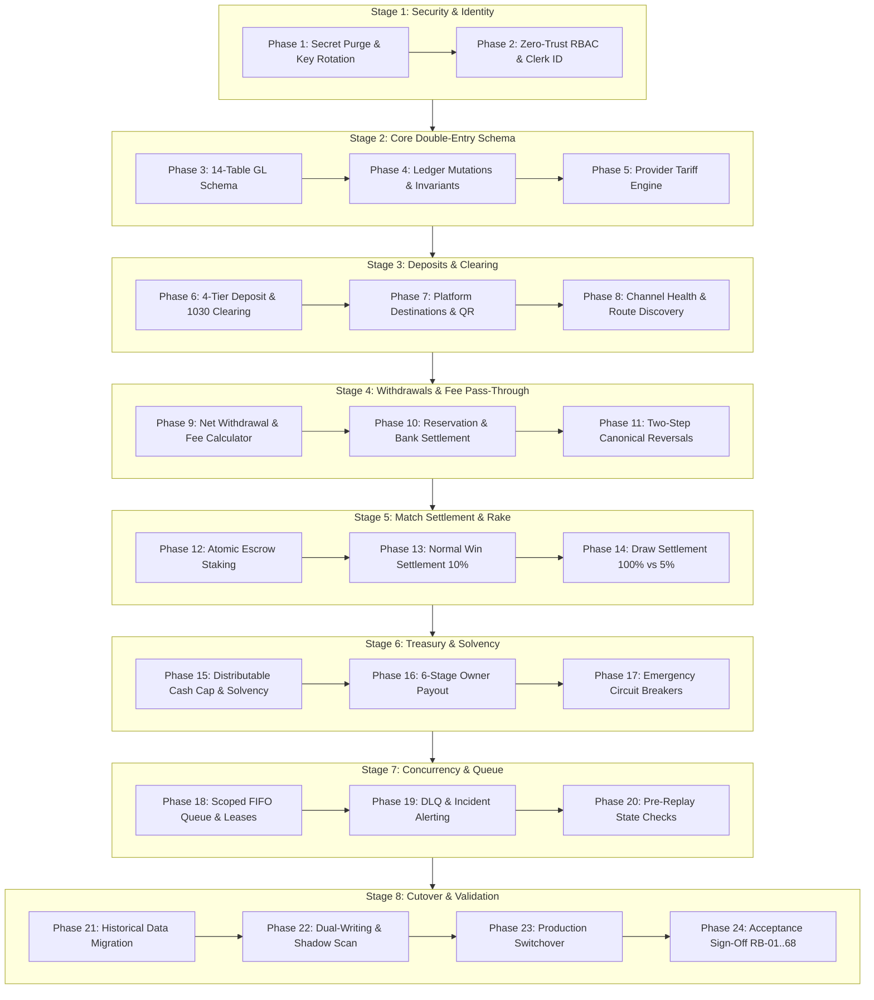

# ABAY CHESS — v4.2.7-PROD
## Master Unified Implementation Roadmap (Stages 1–8, Phases 1–24)
### Reconciling Historical Chapa-Era Tasks with Modern Production Double-Entry Architecture

**Document Version:** 4.2.7-PROD  
**Document Type:** Authoritative Production Implementation Master Plan  
**Target Architecture:** 17 Canonical General Ledger Accounts (including 1050 Overdrafts Receivable, 5020 Promotion Expense, and 5030 Dispute Loss Expense), 14 Database Tables, In-Transit Clearing (1030), Net Withdrawal Guarantee, Scoped FIFO Queue, Zero-Trust RBAC  
**Status:** PENDING OWNER SIGN-OFF — **STRICT NO-IMPLEMENTATION PHASE**  
**Repository Basis:** `Castle-3d-multiplayer-with-ai-vercel-eve-nextjs-clerk-main` (Commit `06acb94b8111b6bcaed8291f781aa9b41bc102ac`)  
**Production Convex Deployment:** `qualified-greyhound-151`  

---

## 1. EXECUTIVE ROADMAP SUMMARY & WORK CATEGORIES

This document provides the **single authoritative implementation roadmap** for Abay Chess. It unifies and supersedes all prior task plans (including the 28-phase Chapa-era plan in `task_plan.md` and the 5-phase cutover plan from v4.2.6), organizing the entire path to production into **8 logical engineering stages comprising 24 dependency-ordered phases**.

```
========================================================================================
                               WORK CATEGORY TAXONOMY
========================================================================================
Category A: Documentation, Specifications & Audits ALREADY COMPLETED (v4.2.7 Deliverables)
Category B: Application Code, Schema & Frontend Work REMAINING TO BE IMPLEMENTED
Category C: External Provider Dependencies & OWNER DECISIONS REQUIRING SIGN-OFF
Category D: Production Cutover, Data Migration & Post-Deployment Verification
========================================================================================
```

---

## 2. STAGE-BY-STAGE IMPLEMENTATION ROADMAP



---

### STAGE 1: SECURITY REMEDIATION, IDENTITY & CREDENTIAL HARDENING
*Priority: P0 Critical | Work Categories: Category B & C*

#### Phase 1: Leaked Key Revocation, Fallback Secret Purge & URL Reconciliation
- **Objective:** Eliminate exposed credentials and align environment variables between Vercel and Convex Cloud.
- **Repository Areas:** `src/lib/payments/verify-et/client.ts`, `src/app/api/finance/deposit/verify/route.ts`.
- **Implementation Steps:**
  1. *Category C:* Owner rotates and revokes `DEFAULT_VERIFY_ET_API_KEY` in Verify.et provider portal.
  2. *Category B:* Delete hardcoded fallback lines 31–44 in `client.ts`. Enforce server-side `process.env.VERIFY_ET_API_KEY`.
  3. *Category B:* Replace hardcoded fallback `https://fast-oyster-971.convex.cloud` on line 29 of `deposit/verify/route.ts` with `process.env.CONVEX_CLOUD_URL`.
  4. *Category B:* Reconcile secret names across Vercel and Convex to `VERIFY_ET_API_KEY`, `VERIFY_ET_WEBHOOK_SECRET`, and `INTERNAL_SERVICE_SECRET`.
- **Verification Criteria:** Grep audit verifies zero hardcoded keys; missing environment variables throw immediate server startup errors.

#### Phase 2: Zero-Trust Authentication, Clerk Subject ID & Staff RBAC Refactoring
- **Objective:** Remove hardcoded email/ID checks, prevent email-only privilege escalation, and implement fine-grained staff permissions.
- **Repository Areas:** `convex/lib/auth.ts`, `src/app/(protected)/admin/page.tsx`, `src/app/(protected)/yyhnan/page.tsx`, `src/app/(protected)/fssmyfkl/page.tsx`.
- **Implementation Steps:**
  1. *Category B:* Purge `ADMIN_EMAILS` and `ADMIN_CLERK_IDS` hardcoded sets from `convex/lib/auth.ts`.
  2. *Category B:* Implement `requireOwner(ctx)` checking `systemConfig.owner_identity == identity.subject`.
  3. *Category B:* Implement `requireAdminPermission(ctx, permission: vAdminPermission)`.
  4. *Category B:* Create dedicated Admin portal route `/fssmyfkl` with masked PII views; restrict `/yyhnan` exclusively to verified Owner.
  5. *Category B:* Create CLI recovery script `scripts/recover-owner.ts` using Convex Admin Deploy Key for break-glass emergency recovery.
- **Verification Criteria:** Acceptance tests **RB-29, RB-30** pass. Non-owner cannot access `/yyhnan`; non-admin cannot access `/fssmyfkl`.

---

### STAGE 2: DATABASE SCHEMA & CORE DOUBLE-ENTRY GENERAL LEDGER
*Priority: P0 Critical | Work Categories: Category B*

#### Phase 3: Convex Schema Expansion (14 Database Tables & 17 Accounts)
- **Objective:** Deploy complete double-entry database schema to Convex Cloud (`qualified-greyhound-151`).
- **Repository Areas:** `convex/schema.ts`, `convex/lib/validators.ts`.
- **Implementation Steps:**
  1. Add 17 canonical accounts to `accounts` table definition (including `1030 Provider Clearing`, active asset `1050 Player Overdrafts Receivable`, `2040 Provider Fees Payable`, `5020 Promotion & Bonus Expense`, and `5030 Dispute & Chargeback Loss Expense`).
  2. Define 14 database tables: `accounts`, `journalTransactions`, `journalPostings`, `dailyReconciliations`, `auditLogs`, `playerBalances`, `depositRequests`, `withdrawalRequests`, `ownerPayoutRequests`, `paymentChannels`, `platformPaymentDestinations`, `durableQueue`, `providerTariffs`, and `systemConfig`.
  3. Enforce 64-bit integer santim validators (`v.int64()`) and compound performance indexes.
- **Verification Criteria:** `npx convex dev` / `tsc --noEmit` compiles cleanly with zero schema validation errors.

#### Phase 4: Core Ledger Posting Engine, Invariants & Idempotency
- **Objective:** Build atomic double-entry mutation pipeline enforcing mathematical invariants.
- **Repository Areas:** `convex/ledger.ts`, `convex/financial/`.
- **Implementation Steps:**
  1. Author `postJournalTransaction(ctx, args)` ensuring $\sum \text{Debits} \equiv \sum \text{Credits}$ within single mutation.
  2. Implement global `idempotencyKey` index check returning existing header on duplicate submissions.
  3. Implement append-only invariant preventing update or deletion of posting lines.
  4. Update `playerBalances` cached projection atomically within the same transaction.
- **Verification Criteria:** Acceptance tests **RB-01, RB-02, RB-03, RB-04, RB-36** pass.

#### Phase 5: Dynamic Provider Tariff Engine & Versioning Subsystem
- **Objective:** Implement versioned, effective-dated fee engine supporting fixed amount brackets, percentages, and statutory taxes.
- **Repository Areas:** `convex/tariffs.ts`, `convex/schema.ts`.
- **Implementation Steps:**
  1. Implement tariff query engine calculating route-specific fees (Telebirr P2P, Telebirr-to-Bank, CBE Account, CBE to Wallet).
  2. Ground calculations in verified official published schedules:
     * Telebirr: Continuous closed santim intervals with documented public gap ($100.00 - 100.99\text{ ETB}$ / $10,000 - 10,099\text{ santims}$) quarantined as `UNRESOLVED_BOUNDARY_QUARANTINED`.
     * CBE: Apply 15% VAT pursuant to VAT Proclamation No. 1341/2024 ($\text{Base} \times 1.15$). Band 1 ($1.00 - 1,000.00\text{ ETB}$ = 0.575 ETB / 57.5 santims) is quarantined as `FRACTIONAL_SANTIM_QUARANTINED` pending CBS voucher proof of debit rounding. Active verified tiers: Band 2 (1.15 ETB), Band 3 (2.30 ETB), Band 4 (3.45 ETB), Band 5 (5.75 ETB).
  3. Enforce `effectiveFrom` and `effectiveUntil` date clamping.
  4. Build mutation to insert new versioned tariff without overwriting historical records.
  5. Enforce Tariff Overlap Invariant: reject any insertion or activation that overlaps the closed santim interval of an existing active tariff for the same route (`ERR_TARIFF_OVERLAP_DETECTED`).
- **Verification Criteria:** Acceptance tests **RB-46, RB-46.1, RB-46.2, RB-47, RB-48, RB-59, RB-60, RB-61, RB-70** pass.

---

### STAGE 3: PAYMENT GATEWAY & DEPOSIT PIPELINE MODERNIZATION
*Priority: P1 High | Work Categories: Category B & C*

#### Phase 6: Four-Tier Deposit Lifecycle & Account 1030 Clearing Integration
- **Objective:** Eliminate solvency float inflation by holding verified deposits in Provider Clearing until bank settlement.
- **Repository Areas:** `src/app/api/finance/deposit/verify/route.ts`, `convex/financial/deposits.ts`.
- **Implementation Steps:**
  1. *Tier 1 (Initiated):* Record deposit request without ledger postings.
  2. *Tier 2 (Provider Verified):* Post Debit `1030 Provider Clearing`, Credit `2010 Player Deposits`. Player can play immediately.
  3. *Tier 3 (Bank Statement Cleared):* Post Debit `1010/1020 Cleared Cash`, Credit `1030 Provider Clearing`.
  4. *Tier 4 (Reconciled):* Monthly bank reconciliation seal.
  5. *Deposit Chargeback / Reversal Protocol (`deposit_reversal_chargeback`):*
     * *Stage 1 — Tier 2 Reversal (Before Bank Settlement - reversing from Account 1030):*
       - Full player balance ($A \ge D$): Debit Account 2010 ($D$), Credit Account 1030 ($D$).
       - Spent funds ($A < D$): Debit Account 2010 for available $A$ (clearing to exactly 0, preserving Zero Negative Balance Invariant), Debit Account 1050 Player Overdrafts Receivable (Active Asset) for $(D - A)$, Credit Account 1030 for full $D$, and immediately freeze player account status (`frozen_overdraft`). Account 3999 is untouched.
     * *Stage 2 — Tier 3 Chargeback (After Bank Settlement - reversing from Account 1010/1020):*
       - Full player balance ($A \ge D$): Debit Account 2010 ($D$), Credit Account 1010/1020 ($D$).
       - Spent funds ($A < D$): Debit Account 2010 for available $A$ (clearing to 0), Debit Account 1050 Player Overdrafts Receivable for $(D - A)$, Credit Account 1010/1020 for full $D$, and freeze player status (`frozen_overdraft`).
     * *Stage 3 — In-Transit Provider Dispute:* When provider debited platform bank but funds have not cleared or are disputed: Debit Account 1040 Provider Receivable / Dispute Suspense, Credit Account 1010/1020.
- **Verification Criteria:** Acceptance tests **RB-13, RB-14, RB-15, RB-16, RB-69, RB-69.1** pass. Account 1030 is excluded from solvency numerator. Account 1050 tracks customer debt separately from Account 3999 reconciliation variances.

#### Phase 7: Platform Payment Destination Management & QR Code Services
- **Objective:** Enforce approved receiving destinations and ensure single active destination per channel.
- **Repository Areas:** `convex/destinations.ts`, `src/components/wallet/`.
- **Implementation Steps:**
  1. Populate approved destinations: CBE Account `1000723226426` and Telebirr `093307470` (`Yared Fikadu Bekele`).
  2. Enforce constraint preventing multiple active destinations for the same channel.
  3. Store QR codes in Convex storage and serve dynamic payment instructions to players.
- **Verification Criteria:** Acceptance test **RB-38** passes.

#### Phase 8: Channel Health Telemetry & Dynamic Route Discovery
- **Objective:** Provide automated gateway health monitoring and enforce unified channel availability rule.
- **Repository Areas:** `convex/channels.ts`, `src/lib/payments/`.
- **Implementation Steps:**
  1. Connect Verify.et gateway ping to `paymentChannels.status`.
  2. Channel is visible on UI iff `paymentChannels.status == "active"` AND `platformPaymentDestinations.isActive == true` AND gateway health check passes.
  3. Keep CBE Birr channel strictly disabled (**OD-04**).
- **Verification Criteria:** Acceptance test **RB-49** passes.

---

### STAGE 4: WITHDRAWAL SUBSYSTEM & ZERO-MARKUP FEE PASS-THROUGH
*Priority: P0 Critical | Work Categories: Category B*

#### Phase 9: Net Withdrawal Guarantee & Dynamic Player Calculator
- **Objective:** Implement policy where player receives 100% of requested amount with provider fees added to wallet deduction.
- **Repository Areas:** `src/components/wallet/WithdrawModal.tsx`, `convex/financial/withdrawals.ts`.
- **Implementation Steps:**
  1. Create dynamic pre-confirmation calculator showing: Requested Amount, Provider Fee, Total Deduction, Amount Received, and Abay Chess Revenue = 0 ETB.
  2. Embed mandatory player-facing service-fee notice.
  3. On confirmation, capture immutable `tariffSnapshot` on `withdrawalRequests`.
  4. Check player has sufficient `availableSantims` to cover total wallet deduction ($X + F$).
- **Verification Criteria:** Acceptance tests **RB-45, RB-52, RB-53, RB-54, RB-64, RB-68** pass.

#### Phase 10: Withdrawal Reservation & Authoritative Bank Settlement
- **Objective:** Reserve requested amount and fee atomically, enforce review workflows, and disburse bank cash.
- **Repository Areas:** `convex/financial/withdrawals.ts`, `src/app/api/finance/withdrawal/`.
- **Implementation Steps:**
  1. Reservation Mutation: Debit `2010 Player Deposits` ($X+F$), Credit `2030 Withdrawal Payable` ($X$), Credit `2040 Provider Fees Payable` ($F$).
  2. Route withdrawals $> 2,000$ ETB to compliance review (**OD-03**).
  3. Execution Mutation: Debit `2030 Withdrawal Payable` ($X$), Debit `2040 Provider Fees Payable` ($F$), Credit `1010/1020 Bank Cash` ($X+F$).
  4. Authoritative Settlement Evidence Requirement: Payout cannot transition from `processing` to `settled` without external clearing statement evidence: `providerTransactionReference`, `externalSettlementReference`, `evidenceType`, and `evidenceReference`. Gateway ACK alone is non-authoritative.
- **Verification Criteria:** Acceptance tests **RB-11, RB-12, RB-57, RB-58, RB-71** pass.

#### Phase 11: Canonical Nine-Phase Withdrawal Lifecycle & Balanced Reversals
- **Objective:** Handle rejected, cancelled, timed-out, failed, and returned transfers with rigorous accounting symmetry.
- **Repository Areas:** `convex/financial/withdrawals.ts`.
- **Implementation Steps:**
  1. *Cancellation / Pre-Transfer Rejection / Failure:* Release 2030 and 2040 back to 2010. Zero cash movement (**RB-18, RB-34, RB-62**).
  2. *Returned Completed Transfer (2-Step):* Step 1 debits Bank Cash and credits 2030; Step 2 debits 2030 and credits Player Deposits 2010 (**RB-17, RB-35, RB-63**).
  3. *Permanent Return Status & Linked Retries:* Returned requests permanently retain status `returned_post_settlement` with recorded `returnReference` and `returnReason`. Any subsequent retry spawns a brand new withdrawal request record with `linkedOriginalRequestId` referencing the prior request (**RB-72**).
- **Verification Criteria:** Acceptance tests pass with balanced journal entries.

---

### STAGE 5: MATCH SETTLEMENT & GAME COMMISSION REVENUE
*Priority: P1 High | Work Categories: Category B*

#### Phase 12: Atomic Match Escrow Staking & Concurrency Guards
- **Objective:** Lock player stakes into escrow upon match start with race-condition prevention.
- **Repository Areas:** `convex/games.ts`, `convex/queue.ts`.
- **Implementation Steps:**
  1. Post Debit `2010 Player Deposits` (both players), Credit `2020 Active Match Escrow` (total pot).
  2. Verify available balance before lock. Prevent double-spend during rapid successive joins.
- **Verification Criteria:** Acceptance tests **RB-09, RB-10** pass.

#### Phase 13: Normal Win Settlement (10% Rake) & Revenue Ledgering
- **Objective:** Settle completed match in general ledger with exact 10% platform commission rake.
- **Repository Areas:** `convex/lib/games.ts:281-340`, `convex/games.ts`.
- **Implementation Steps:**
  1. Calculate integer santim split: Winner receives 90% of pot; Platform receives 10% rake.
  2. Post Debit `2020 Active Match Escrow` (100%), Credit `2010 Player Deposits` (Winner: 90%), Credit `4010 Platform Commission Revenue` (10%).
  3. Update player ratings and game status atomically.
- **Verification Criteria:** Acceptance tests **RB-05, RB-08, OP-02** pass.

#### Phase 14: Draw Settlement Engine (100% Organic vs Mutual Draw Alternatives)
- **Objective:** Separate organic draws from mutual accepted draws in backend accounting.
- **Repository Areas:** `convex/lib/games.ts:209-280`.
- **Implementation Steps:**
  1. *Organic Draw (Stalemate, 50-move, repetition):* Post Debit `2020 Escrow` (100%), Credit `2010 Player Deposits` (White 50%, Black 50%). Zero rake (**RB-06, RB-44**).
  2. *Mutual Accepted Draw (BLOCKED Pending OD-09):* Document Alternative 1 (5% of stake = 5% pot rake) and Alternative 2 (2.5% of stake = 2.5% pot rake). Rake execution blocked until OD-09 ratification; active fallback is 100% refund (**RB-07, OP-03**).
- **Verification Criteria:** Acceptance tests **RB-06, RB-07, RB-44** pass.

---

### STAGE 6: TREASURY GOVERNANCE, DISTRIBUTABLE CASH & SOLVENCY
*Priority: P0 Critical | Work Categories: Category B & C*

#### Phase 15: Dynamic Distributable Cash Cap & Solvency Monitoring
- **Objective:** Prevent owner over-distribution and continuously calculate platform solvency ratio.
- **Repository Areas:** `convex/solvency.ts`, `convex/admin/finance.ts`.
- **Implementation Steps:**
  1. Compute Solvency Denominator: $\sum_{a \in \mathcal{L}} \text{CreditBalance}(a) + \text{PendingCommitments}$, where $\text{PendingCommitments}$ sums unposted liabilities queued in `durableQueue` (in states `pending`, `claimed`, `processing`) that have not yet posted to the ledger, preventing unposted queue float from masking liabilities.
  2. Compute Solvency Ratio: $(\text{Balance}(1010) + \text{Balance}(1020)) / (\text{Total Liabilities} + \text{PendingCommitments})$.
  3. Compute Distributable Cash Cap:
     $$\mathbf{DistributableCap} = \max(0, \min(\text{BookEquity}, \text{EligibleCashSurplus}))$$
     where:
     $$\text{BookEquity} = \max(0, \text{Balance}(3010) - \text{Balance}(3020) - \text{CapitalReserve} - |\text{Balance}(3999)|)$$
     $$\text{EligibleCashSurplus} = \max\left(0, \ (\text{Balance}(1010) + \text{Balance}(1020)) - \left\lceil \frac{105 \times \text{TotalOutstandingLiabilities}}{100} \right\rceil - \text{OperatingBuffer}\right)$$
     with $\text{CapitalReserve} = 100,000\text{ santims}$ (1,000 ETB), $\text{OperatingBuffer} = 100,000\text{ santims}$ (1,000 ETB), and Account 3999 deducted exactly once via single absolute value. Prevents negative caps and strictly guarantees 105% post-distribution cleared cash coverage.
  4. Enforce pre-authorization check: projected solvency must remain $\ge 105\%$ (**OD-02**).
- **Verification Criteria:** Acceptance tests **RB-21, RB-22, RB-31, RB-32, RB-66** pass.

#### Phase 16: Authoritative Six-Stage Owner Payout Lifecycle
- **Objective:** Enforce multi-stage governance for platform profit distributions.
- **Repository Areas:** `convex/financial/ownerPayouts.ts`, `src/app/(protected)/yyhnan/`.
- **Implementation Steps:**
  1. Lifecycle: `draft` $\rightarrow$ `requested` $\rightarrow$ `authorized` $\rightarrow$ `escrowed` $\rightarrow$ `externally_confirmed` $\rightarrow$ `completed`.
  2. Escrow Mutation: Debit `3010 Retained Earnings`, Credit `2090 Owner Payout Payable`.
  3. Execution Mutation: Debit `2090 Owner Payout Payable`, Credit `1010/1020 Bank Cash`. Requires verified bank statement reference (**RB-23**). Receipt upload is supporting evidence only.
  4. Snapshot immutable destination on payout creation (**RB-41**).
- **Verification Criteria:** Acceptance tests **RB-21..24, RB-41, OP-06** pass.

#### Phase 17: Emergency Circuit Breakers & Solvency Breach Handling
- **Objective:** Automatically lock withdrawals and throttle gameplay if solvency falls below safety thresholds.
- **Repository Areas:** `convex/circuitBreaker.ts`, `convex/schema.ts`.
- **Implementation Steps:**
  1. If Solvency $< 105\%$ (Caution): Block owner payouts, review withdrawals $> 2,000$ ETB, cap match stakes at 50 ETB (**OD-10**).
  2. If Solvency $< 100\%$ (Critical Breach): Automatically lock all withdrawals, alert Owner, require capital injection to unlock.
- **Verification Criteria:** Acceptance test **OP-07** passes.

---

### STAGE 7: ASYNCHRONOUS CONCURRENCY, SCOPED QUEUE & RESILIENCY
*Priority: P1 High | Work Categories: Category B*

#### Phase 18: Scoped FIFO Queue (`durableQueue`) & Lease Locking Engine
- **Objective:** Eliminate race conditions and ensure strictly ordered asynchronous processing.
- **Repository Areas:** `convex/queue.ts`, `convex/schema.ts`.
- **Implementation Steps:**
  1. Implement `durableQueue` with partitioned `scopeKey` (e.g. `game:<gameId>` or `user:<userId>`).
  2. Workers claim tasks atomically with 30-second lease lock (`leaseExpiresAt`).
  3. Expired worker commits are fenced off and rejected.
- **Verification Criteria:** Acceptance tests **RB-25, RB-26, RB-39** pass.

#### Phase 19: Dead-Letter Queue (DLQ), Exponential Backoff & Incident Alerting
- **Objective:** Manage failed async operations without blocking queues or losing event history.
- **Repository Areas:** `convex/queue.ts`.
- **Implementation Steps:**
  1. Exponential retry schedule: 10s, 30s, 2m, 10m, 30m (**OD-06**).
  2. After 5 retries, move task to `dead_letter` status with `dlqReason`.
  3. Send high-priority alert to staff dashboard. Manual replay tool for admins.
- **Verification Criteria:** Acceptance test **RB-28** passes.

#### Phase 20: Pre-Replay State Revalidation & Worker Crash Recovery
- **Objective:** Prevent duplicate financial postings during queue retries and system restarts.
- **Repository Areas:** `convex/queue.ts`.
- **Implementation Steps:**
  1. Before retrying a settlement task, worker queries underlying game/deposit record.
  2. If already settled, task is marked completed immediately without re-posting.
- **Verification Criteria:** Acceptance test **RB-27** passes.

---

### STAGE 8: PRODUCTION CUTOVER, DATA MIGRATION & FINAL ACCEPTANCE
*Priority: P0 Critical | Work Categories: Category B, C & D*

#### Phase 21: Historical Data Migration & Account 3999 Reconciliation
- **Objective:** Reconstruct opening balances from legacy single-entry tables and external bank statements.
- **Repository Areas:** `scripts/migrate-ledger.ts`.
- **Implementation Steps:**
  1. *Category C:* Execute during scheduled maintenance window: Sunday 02:00–04:00 EAT (**OD-05**).
  2. Freeze new deposits/withdrawals during migration (15-minute freeze).
  3. Sum legacy user balances. Reconcile against verified CBE/Telebirr statements.
  4. Post baseline transaction: Debit `1010/1020 Bank Cash`, Credit `2010 Player Deposits`, Offset to `3999 Historical Discrepancy`.
- **Verification Criteria:** Acceptance tests **RB-31, RB-33** pass. Formula: $\text{Assets} \equiv \text{Liabilities} + \text{Equity} + \text{Discrepancy}$.

#### Phase 22: Dual-Writing & Real-Time Shadow Ledger Scanning
- **Objective:** Run legacy tables and new double-entry ledger in parallel to verify 100% balance consistency.
- **Repository Areas:** `convex/financial/`.
- **Implementation Steps:**
  1. Mutations write to both legacy `wallets`/`transactions` and new general ledger.
  2. Background job continuously compares legacy balance against `playerBalances.availableSantims`.
  3. Run shadow verification for 7 consecutive days in production.
- **Verification Criteria:** Acceptance test **RB-40** passes with zero discrepancy detected.

#### Phase 23: Primary General Ledger Switchover & Legacy Freeze
- **Objective:** Switch UI and backend readers to General Ledger as authoritative source of truth.
- **Repository Areas:** Frontend components, Next.js API routes, Convex queries.
- **Implementation Steps:**
  1. Set legacy tables to read-only.
  2. Switch `/wallet`, `/fssmyfkl`, and `/yyhnan` to read from `playerBalances` and `journalPostings`.
  3. Decommission legacy Chapa adapter code.
- **Verification Criteria:** Production platform operates exclusively on double-entry general ledger.

#### Phase 24: Comprehensive Verification, Acceptance Sign-Off & Cleanup
- **Objective:** Execute complete acceptance suite in production and obtain final Owner sign-off.
- **Repository Areas:** Entire codebase, test suites.
- **Implementation Steps:**
  1. Run all 68 Rollback Tests (**RB-01 through RB-68**).
  2. Run all 8 Operational Scenarios (**OP-01 through OP-08**).
  3. Archive legacy tables and generate final reconciliation audit report.
  4. Owner executes formal sign-off.
- **Verification Criteria:** 100% of acceptance tests pass; zero unresolved defects.

---

## 3. DEPENDENCY & PRE-REQUISITE MATRIX

| Phase ID | Phase Name | Direct Prerequisites | Blocked by Owner Decisions? |
| :--- | :--- | :--- | :--- |
| **Phase 1** | Leaked Key Revocation & URL Reconciliation | None (Immediate P0) | No (Immediate Security Fix) |
| **Phase 2** | Zero-Trust RBAC & Clerk ID Refactoring | Phase 1 | No |
| **Phase 3** | Convex Schema Expansion (14 Tables, 17 Accounts)| Phase 2 | No |
| **Phase 4** | Core Ledger Posting Engine & Invariants | Phase 3 | No |
| **Phase 5** | Dynamic Provider Tariff Engine | Phase 3 | **OD-11, OD-12** |
| **Phase 6** | 4-Tier Deposit & Account 1030 Clearing | Phase 4 | No |
| **Phase 7** | Platform Payment Destinations | Phase 6 | No |
| **Phase 8** | Channel Health & Route Discovery | Phase 7 | **OD-04** (CBE Birr Disabled) |
| **Phase 9** | Net Withdrawal Guarantee & Fee Calculator | Phase 5, Phase 8 | No |
| **Phase 10** | Withdrawal Reservation & Bank Settlement | Phase 4, Phase 9 | **OD-03** (Review Limit) |
| **Phase 11** | Canonical Nine-Phase Withdrawal Reversals | Phase 10 | No |
| **Phase 12** | Atomic Match Escrow Staking | Phase 4 | No |
| **Phase 13** | Normal Win Settlement (10% Rake) | Phase 12 | No |
| **Phase 14** | Draw Settlement Engine (100% vs 5%) | Phase 13 | **OD-09** (Organic Draw Ratification) |
| **Phase 15** | Distributable Cash Cap & Solvency | Phase 4, Phase 6 | **OD-01, OD-02** |
| **Phase 16** | 6-Stage Owner Payout Lifecycle | Phase 15 | **OD-13** (High-Value Timelock) |
| **Phase 17** | Emergency Circuit Breakers | Phase 15 | **OD-10** (Stake Limit) |
| **Phase 18** | Scoped FIFO Queue & Lease Locking | Phase 4 | No |
| **Phase 19** | Dead-Letter Queue & Incident Alerts | Phase 18 | **OD-06** (Retry Policy) |
| **Phase 20** | Pre-Replay State Revalidation | Phase 18 | No |
| **Phase 21** | Historical Migration & Account 3999 | Phases 1–20 | **OD-05, OD-07** |
| **Phase 22** | Dual-Writing & Shadow Scanning | Phase 21 | No |
| **Phase 23** | Primary General Ledger Switchover | Phase 22 | No |
| **Phase 24** | Acceptance Sign-Off (RB-01..68) | Phase 23 | Final Owner Sign-Off |

---
**END OF UNIFIED ROADMAP — ABAY CHESS v4.2.7-PROD**  
*STATUS: PENDING OWNER APPROVAL — IMPLEMENTATION PROHIBITED*
